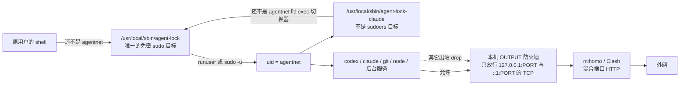

# agent-lock：按账户把 Codex / Claude 锁到本机 HTTP 代理

| 项 | 值 |
| --- | --- |
| 作者 | placeholder |
| 日期 | 2026-11-05 |
| 修订 | 2026-11-05。按评审改为：nft 具名计数器与 `destroy` 同一事务；Linux 启动脚本用 `agentnet` 组 0750，凭据目录靠安装后 `setfacl` 加显式 mask，并靠 `doctor --repair` 补回 `chmod 0600` 清掉的 mask；macOS Claude 钥匙串 v1 不共享；Windows 去掉会落到回环的 RemoteAddress 关键字；pf 锚点插在 `anchor "com.apple/*"` 之前，卸载不 `pfctl -d`；切换器与 Claude 包装脚本分开。第二轮：0750 的组来自 `bin_dir` 的 setgid，无特权写入不 `chown`；预检改为 `sudo -n -l`；sudoers 关掉 `set_logname` / `set_home` / `always_set_home`，并用 sudo 之前的快照恢复 `USER` / `LOGNAME` / `HOME`；IFS 含换行且不 export，sudoers 用逐个字面名字的 `env_delete` 去掉动态链接器变量；`cli.py` 行号按当前树重引；Claude 包装脚本不再 `unset` 辅助变量。第三轮：`bind-bin` 在或入 setgid 与组读、组执行之后清掉 `S_IWGRP`，`0775` 变成 `2755`；doctor 的 `bin-dir` 在目录仍可被组写时失败。用户拍板：`--allow-tcp` 进入 v1，只接受 `127.0.0.1:PORT` 与 `::1:PORT`，默认空列表，三个后端都留位置；Windows 上的 Claude 必须从 `runas /user:agentnet` 窗口启动，不写 settings，不把 `CLAUDE_CODE_PROCESS_WRAPPER` 说成有效，不改计划任务，不存密码。帮助示例与 `completion bash|zsh|fish|powershell` 进入 v1，英文帮助和补全脚本都从同一个 argparse 解析器生成。本轮把 bind-bin 的 sudo 切分、bash/zsh 的 `lock` 分支、PowerShell 的 `TabExpansion2`、fish 的 bind-bin 路径规则，以及 bash 3.2 的引用拆分折了进去。PowerShell 在 `--port`、`--allow-tcp`、`--controller` 和 `exec --` 上执行 `return $null`；Windows PowerShell 5.1 的验收是 `MethodInvocationException`，不是 `CompletionResult.Null` |
| 状态 | Implemented in v0.1.0; this document is the behavior v0.1.0 follows |
| 草案位置 | 本文件（scratch）。入库后的正文路径是新仓库 `/Users/jakoes/VSCodeProjects/ai/agent-lock/docs/feature/feature-agent-lock.md` |
| 新仓库 | `/Users/jakoes/VSCodeProjects/ai/agent-lock`，与 `multi-codex` 同级，独立 git。今天仓库还不存在，下文路径都是要新建的，不是现有代码 |

## Overview

终端里启动的 Codex 和 Claude，从进程起来到退出，只能连接本机 Clash / mihomo 的混合端口（HTTP 代理）。直连、DNS、局域网和本机其它 TCP 端口一律丢掉。用户用 `--allow-tcp` 点名的 `127.0.0.1:PORT` 或 `::1:PORT` 除外；不传这个旗标时一个额外端口都不放行。子进程（git、node，以及 Claude 从二进制绝对路径拉起的后台服务）必须和父进程落在同一个没有管理员权限的专用账户 `agentnet` 上，防火墙只认这个账户的 uid / SID。

实现是一个独立工具 `agent-lock`，不放进 `multi-codex`、`multi-claude`、`mihomo-cli` 或 `ownexit`。`multi-codex` / `multi-claude` 只加一层默认关闭的启动前缀：用户显式打开之后，启动命令才经包装脚本切到 `agentnet`。打开之前，启动脚本的字节与现在逐字相同。环境变量和现有 `netcheck` 继续只做启动前检查，不声称能防止运行中直连。

`agent-lock install` 在 POSIX 上会改用户级 Claude `settings.json`，让之后尊重 `CLAUDE_CODE_PROCESS_WRAPPER` 的 Claude 都走包装脚本。这与「集成默认关闭」不矛盾：关闭保证的是 `multi-codex` / `multi-claude` 的启动脚本字节不变，不是保证没跑过 `install` 的机器上 Claude 完全无感。

## Background & Motivation

`multi-codex` 已经把代理写进启动命令，但这不是强制。`src/multi_codex/launcher.py` 的 `_proxy_lines`（141–163 行）对 HTTP 代理导出 `HTTPS_PROXY` / `HTTP_PROXY` 及小写形式，**不**写 `ALL_PROXY`，并 `unset ALL_PROXY all_proxy`；`NO_PROXY` 在原值后追加 `localhost,127.0.0.1,::1`。Windows 的对应实现是同文件的 `account_env`（329–354 行）。第 349 行把继承到的 `NO_PROXY` 再拼上 `_NO_PROXY_HOSTS`，**不论原值里是否已经有这些主机**。账户环境变量不能再设置这些名字：`src/multi_codex/config.py` 的 `PROXY_ENV_VARS` 与 `validate_env_key` 会拒绝，代理只能走 `multi-codex proxy`。`normalize_proxy`（`src/multi_codex/config.py` 368–407 行，函数在 407 行 `return`）把纯端口展开成 `http://127.0.0.1:<端口>`。

这挡不住运行中直连。`src/multi_codex/netcheck.py` 开头写明：只在启动那一刻检查一次；Codex 的 `system_proxy_fallback` 默认开启，代理断开后仍可能直连；桌面版和 VS Code 插件不经过启动命令。`docs/feature/feature-network-check.md` 第 2 节非目标的原句是：要“绝不直连”需在系统防火墙层限制 Codex 进程，不在本工具范围内。本方案把那句里的防火墙做成独立工具，不把它做回 `multi-codex`。`README.zh-CN.md`「启动前网络检查」的局限（437–438 行）已经告诉用户：用防火墙禁止 Codex 除经代理之外的联网。本方案把这句话做成工具。

`multi-claude` 的代理更窄。`src/multi_claude/config.py` 的 `PROXY_SCHEMES` 只有 `http` / `https`；`normalize_proxy` 对 `socks5` / `socks5h` 直接报错，并指向 Claude Code 网络文档。`src/multi_claude/launcher.py` 的 `_proxy_lines`（110–128 行）同样只导出 HTTP(S) 代理并清掉 `ALL_PROXY`。`src/multi_claude/accounts.py` 的 `settings_proxy_overrides`（377–416 行）会警告 `settings.json` / `.claude.json` 的 `env` 覆盖启动命令里的代理变量——Claude 以 settings 为准。`Account.to_dict`（同文件 `config.py` 101–103 行）**总是**写出 `env` 和 `args`，不能拿它当「空字段就省略」的先例。

官方 corporate launcher 文档（https://code.claude.com/docs/en/corporate-launcher，2026-11-05 核对）要求：

- `CLAUDE_CODE_PROCESS_WRAPPER` 必须是包装脚本的绝对路径，写在用户级 `settings.json` 的 `env` 里。shell `export` 不够。项目级 `.claude/settings.json` 和 `settings.local.json` 里的这个变量被忽略。
- Claude 用「包装脚本 + Claude 命令的 argv」启动。脚本必须以 `exec "$@"` 结束，不能 fork 之后退出。
- 只替换 PATH 上的 `claude` 盖不住从二进制绝对路径拉起的后台服务。
- 继承来的变量要原样传下去。允许新增，不允许丢弃。会话令牌、模型、`CLAUDE_CODE_PROCESS_WRAPPER` 本身都在这组环境里。`/status` 会报告 launcher mismatch。
- 该环境变量在 Claude Code v2.1.208 之前被忽略。`processWrapper` 键在 v2.1.210 之前被忽略。本方案只用环境变量，doctor 的版本下限是 2.1.208。
- Windows 忽略该变量，进程不经包装就启动。
- 深链、Chrome native-messaging host、tmux `--worktree` 重新拉起的进程不是包装进程的子进程。`src/multi_claude/platform.py` 33–36 行的 `DAEMON_SERVICE_NAME = "com.anthropic.claude-daemon"` 与 `DAEMON_PLIST` 是登录用户的 LaunchAgent / systemd user unit。`daemon_service_path`（525–535 行）在 macOS 上是 `~/Library/LaunchAgents/<name>.plist`，在 Linux 上是 `$XDG_CONFIG_HOME/systemd/user/<name>.service`。`_daemon_service`（538–547 行）只要服务文件还在就当作占用，不管 pid 此刻是否在跑。

`mihomo-cli` 不能承载这个功能。`README.zh-CN.md` 写明只支持带 systemd 的 Linux；`src/mihomo_cli/platform/darwin.py` 是占位，每个方法都抛 `NotSupported`；`platform/__init__.py` 的 `get_platform` 在 darwin 上返回 `DarwinPlatform`，只在其它非 Linux 平台抛 `NotSupported`；darwin 那个类的每个方法再抛 `NotSupported`。没有 Windows 实现。它自己的内核配置（`src/mihomo_cli/render.py` 96–103 行）是 `mixed-port` 取自 state、`bind-address: 127.0.0.1`、`allow-lan: false`、TCP `external-controller` 置空、unix 套接字名是相对 `-d` 的 basename。默认混合端口是 `src/mihomo_cli/state.py` 的 `DEFAULT_PORT = 7897`。这是代理的一种来源，不是账户防火墙。

`multi-grok` 是同一族的第三个启动器（`src/multi_grok/launcher.py` 的 `render`，61–94 行，最后 `exec grok`）。`platform.is_supported` 同样只含 macOS 与 Linux。v1 不集成它。锁如果做进某一个 `multi-*`，另外两个要么复制一套防火墙，要么漏掉；uid 规则本来就与哪个 CLI 无关。`ownexit` 只确认仓库与 `multi-codex` 同级存在，本方案没有审它的内部实现，也不把功能并进去。

Clash / mihomo 侧的既有事实，端口发现要尊重：

- 混合端口同时接受 HTTP 和 SOCKS。本工具只使用 `http://127.0.0.1:<混合端口>`。不设置 `ALL_PROXY`。Claude Code 不支持 SOCKS。
- 全局模式不会另开一个端口。不要去找「全局端口」。
- 不要放行 external-controller（常见 `9090` / `9097`）。那是管理口，不是代理。
- Clash Verge Rev 默认混合端口是 7897。手写 mihomo 配置常见 7890。本仓库和相邻仓库里没有 7892 这个字面量；它只出现在 mihomo 文档示例里。以本机 `GET /configs` 为准，发现失败就要求用户传入，不猜。
- `allow-lan` 必须保持关闭，内核只绑 `127.0.0.1`。`mihomo-cli` 已经这样渲染；Verge 或手写配置不一定。
- TUN 不是本功能的实现。规则按 uid 丢本机 OUTPUT 上的非代理流量。别的用户开着 TUN 不受影响。不用 mihomo 的 `PROCESS-NAME` 或 `include-uid` 代替防火墙。

## Goals & Non-Goals

**目标**

1. 新建独立仓库 `agent-lock`，提供 `install`、`uninstall`、`doctor`、`exec`、`bind-bin`，以及混合端口发现。
2. Linux（nftables + systemd oneshot）、macOS（pf anchor）、Windows（按用户 SID 的出站阻止规则）三套都能安装、能卸载、能被 doctor 判定。
3. `agentnet` 无 sudo、无 Administrators。原用户只对 `/usr/local/sbin/agent-lock` 这一条免密 sudo（Windows 没有对应物，见该节）。Claude 的包装脚本不是第二条 sudoers。
4. 两条脚本分工。切换器在「还不是 agentnet」时切到 agentnet。已经是 agentnet 时，切换器按调用目标决定要不要去掉 `ALL_PROXY`，然后 exec。Claude 包装脚本已经是 agentnet 时只追加代理变量，不 `unset` 任何名字，再 `exec "$@"`。
5. `multi-codex` 与 `multi-claude` 各做一个默认关闭的薄集成。关闭时启动脚本字节级不变，包括 `tests/data/posix-launchers-44cb4c1.json` 所锁定的 POSIX 基线（`launcher.render` 的 docstring 要求 `net_check` 为假时与该快照逐字相同；本集成同样要求 `agent_lock` 未开启时逐字相同）。
6. 改端口时同时改防火墙、两条包装脚本和已登记的 Claude settings。doctor 发现它们不一致就失败。
7. `uninstall` 去掉用户、规则、sudoers、包装脚本；不删除符号链接 / 目录联接的目标（那是原用户的 `.codex` / `.claude` / 账号目录）。不 `pfctl -d`。
8. POSIX 上 `install` 写入用户级 Claude `settings.json` 的 `env.CLAUDE_CODE_PROCESS_WRAPPER`，指向 Claude 包装脚本的绝对路径。此时 `multi-*` 的 `agent_lock` 仍可以是关的，启动脚本字节不变。不把 `HTTP_PROXY` 写进 settings，不设置 `CLAUDE_CODE_SHELL_PREFIX`。Windows 上不写 Claude settings，见目标 10。
9. v1 的 `install` 接受可重复的 `--allow-tcp`。每一项只能是 `127.0.0.1:PORT` 或 `::1:PORT`。不传则 `extra_tcp` 为空列表，三个防火墙后端都不额外放行。help 写明：被放行的回环服务若再自行拨出网络，就是代理之外的第二条出口。
10. Windows 上的 Claude 必须从 `runas /user:agentnet` 打开的窗口启动。v1 不在 Windows 上写 Claude settings，也不把 `CLAUDE_CODE_PROCESS_WRAPPER` 说成在 Windows 上有效。不改计划任务，不存密码。该窗口里创建的子进程由 SID 规则盖住。doctor 发现仍以原用户运行、且会启动 Claude 的计划任务或服务时只 warn。
11. 英文 `--help`。顶层一句工具说明，末尾是 `examples:`。每个子命令的 `-h` 有 usage、一句说明、argparse 自己的选项说明，以及 2～4 条 `examples:`。缺一组示例时 `build_parser` 直接失败。
12. `agent-lock completion bash|zsh|fish|powershell` 把补全脚本写到 stdout，退出 0。子命令名、选项和 `choices` 在生成脚本时从解析器读出，不另维护一份清单。

**非目标**

- 不改 `netcheck` 的含义。它仍然只在启动前检查一次，仍然不声称能防止运行中直连。不把防火墙逻辑搬进 `src/multi_codex/netcheck.py`。
- 不覆盖 Codex 桌面版、VS Code 插件自行拉起的进程、`multi-codex app`。这些今天就不经过账号启动命令（`feature-network-check.md` 非目标）。用户要锁它们，必须自己用 `agent-lock exec` 启动，v1 不改 `cmd_app`。
- 不修改 Clash / mihomo 的配置，不切换模式，不开 TUN，不写 `allow-lan`。只读 `GET /configs`。
- 不做进 `mihomo-cli` 或 `ownexit`。不在 v1 集成 `multi-grok`。
- 不拦截 Unix domain socket（`docker.sock`、mihomo 的 controller 套接字）。IP 防火墙看不到它们。风险写在安全节，不假装封住了。
- 不防一个手里有 sudo 密码、愿意自己改防火墙的人。威胁模型是拦住 agent 及其子进程直连。
- 不传 `--allow-tcp` 时不开放额外本机 TCP 端口。该旗标只接受 `127.0.0.1:PORT` 与 `::1:PORT`，默认是空列表。不默默放行 MCP、Ollama 或 `mihomo-cli` 的固定节点端口。
- 不用 Landlock、`sandbox-exec`、网络命名空间、TUN 进程名、Windows 按 exe 路径作为主机制。理由在「备选」节。
- v1 不把原用户的 macOS 登录钥匙串共享给 `agentnet`。见账户节。

## Proposed Design

### 总览



其它 Unix 用户和 Windows 上的其它 SID 不匹配这些规则，出站策略保持原样。原用户自己的浏览器、TUN、直连都不变。doctor 用「原用户直连 1.1.1.1:443 仍然成功」证明没有锁死整台机器。

### 仓库与进程边界

建议布局（全部新建）：

```text
agent-lock/
  pyproject.toml          # Python 3.8+，只依赖标准库，与 multi-codex 相同的下限
  README.zh-CN.md
  docs/feature/feature-agent-lock.md
  src/agent_lock/
    cli.py                # install / uninstall / doctor / exec / completion；帮助示例表
    completion.py         # 从解析器生成 bash / zsh / fish / powershell 补全
    discover.py           # GET /configs，不打印 secret
    state.py              # 0600 的本机状态
    wrapper.py            # 渲染两条包装脚本；不读 secret
    doctor.py             # 判定与退出码
    linux.py              # nft 文本、systemd unit、setfacl
    darwin.py             # pf anchor、pf.conf 补丁
    windows.py            # NetFirewall 规则、本地用户、CreateProfile
  tests/
    test_discover.py
    test_wrapper.py
    test_nft.py
    test_pf.py
    test_windows_rules.py
    test_doctor_parse.py
    test_help.py
    test_completion.py
```

两个名字不要混：

| 名字 | 是什么 | 不是什么 |
| --- | --- | --- |
| `agentnet` | 无管理员权限的专用 OS 账户，也是它的私有组。防火墙只匹配这个 uid / SID | 不是仓库名，不是命令名 |
| `agent-lock` | 工具名。pipx 入口是管理命令。`/usr/local/sbin/agent-lock` 是切换器，也是唯一的免密 sudo 目标 | 切换器里没有 `install`。Python 入口不是 sudoers 目标 |
| `agent-lock-claude` | `/usr/local/sbin/agent-lock-claude`。Claude settings 指向它。已经是 agentnet 时零 `unset` | 不在 sudoers 里。不是第二条免密 root |

管理命令（`agent-lock install`）如果需要 root，走普通 `sudo`（会要密码），**不**写进 `NOPASSWD`。免密条目只有切换器。切换器内部永远把 root 降到 `agentnet`，从不在 root 下 exec 用户命令。

Windows 没有 `/usr/local/sbin`，也没有免密 `runas`。切换器是 `C:\ProgramData\agent-lock\agent-lock.cmd`。没有 Claude 包装脚本：Windows 忽略 `CLAUDE_CODE_PROCESS_WRAPPER`，v1 不把这个变量说成有效，也不在 Windows 上写 Claude settings。Claude 必须从 `runas /user:agentnet` 打开的窗口启动。这个窗口里创建的子进程仍是 `agentnet` 的 SID，出站规则盖住它们。不改计划任务，不存密码。doctor 发现仍以原用户运行、且会启动 Claude 的计划任务或服务时只 warn。

### 命令面

```text
agent-lock install [--port N] [--controller ADDR] [--secret-stdin]
                   [--claude-dir PATH ...] [--share-dir PATH ...]
                   [--trust-exec PATH ...]
                   [--allow-tcp 127.0.0.1:PORT ...]
agent-lock uninstall
agent-lock doctor [--json] [--repair]
agent-lock exec -- COMMAND [ARG ...]
agent-lock bind-bin PATH
agent-lock completion bash|zsh|fish|powershell
```

`install` 可重复执行。账户已存在就不要再创建、不要再要密码。防火墙、包装脚本、sudoers、授权、Claude settings 收敛到同一端口。改端口就是再跑一次 `agent-lock install --port N`（或省略 `--port` 重新发现）。不另做一套会忘记某一边的 `set-port`。

`--allow-tcp` 可重复，v1 就有这个旗标。每一项必须恰好是 `127.0.0.1:PORT` 或 `::1:PORT`，端口为 1 到 65535。不接受 `127.0.0.0/8` 里的其它地址、主机名、不带端口的写法，也不接受非这两个字面量的地址；这些都是参数错误，退出 2。不传则 `state.extra_tcp` 为空列表。再次 `install` 时，这份列表等于本次命令行上的旗标，没传就清空，不从旧状态继承。三个防火墙后端都读这一份列表，空列表不生成额外放行。help 写明：被放行的回环服务若再自行拨出网络，就是代理之外的第二条出口。本工具不追踪那条连接。

`bind-bin` 只在 Linux 上有。它不是切换器，不进 `NOPASSWD`。调用者用普通 `sudo`（会要密码）以 root 运行。作用写在账户节：给一个已有目录加上组 `agentnet` 和 setgid，让之后在这个目录里新建的文件继承该组。不 `chown` 目录里已有的文件。

`doctor --repair` 只重做 Linux / macOS 上会被 `chmod` 清掉的授权（见账户节），不改防火墙端口，不改 settings。

退出码：

| 码 | 命令 | 含义 |
| --- | --- | --- |
| 0 | 全部 | 成功。doctor 表示每一项必查都过了 |
| 1 | doctor / install | 有必查项失败，或安装中途验证失败。doctor 先打完所有项再退出，不在第一项停下 |
| 2 | 全部 | 参数不合法。未实现的 doctor **不用**这个码 |
| 3 | doctor / exec | 还没安装（没有状态文件或没有包装脚本）。PR 1 的 doctor 占位也退出 3 |
| 4 | install / doctor | 前提不成立：没有 `nft` / `pfctl`、`nft` 不接受 `destroy`、`pfctl -nf` 失败、firewalld 正在运行、Windows 出站默认不是 Allow、组策略禁止合并本地规则 |
| 126 | exec | 切账户被拒绝。切换器把失败的 `sudo -n -l /usr/local/sbin/agent-lock` 映射成 126，不用 sudo 自己的 1，也不用 `sudo -n -v` |
| 127 | exec | 切换之后命令不存在 |

`exec` 成功时不返回：进程被替换成目标命令。

### 帮助与补全

帮助文本用英文，和 `multi-codex` 一样。本设计文档仍是简体中文。`on` / `off` 不在 `agent-lock` 上，在 `multi-codex agent-lock` 和 `multi-claude agent-lock` 上，示例归 PR 5 和 PR 6。

照 `src/multi_codex/cli.py` 的做法，不手写第二份命令清单：

- `COMMAND_GROUPS`（41–74 行）是 `(组名, ((子命令, 一句英文说明), ...))`。`COMMAND_SUMMARY`（75 行）由它摊平。
- `TOP_EXAMPLES`（79–87 行）和 `COMMAND_EXAMPLES`（89–222 行）的元素都是 `(命令行, 说明)`。
- `_examples_text`（225–230 行）打出 `examples:`，命令行左对齐补到本组最长命令加 2，再接说明。
- `HELP_EXAMPLES`（233 行）是顶层示例再加一行 `Run multi-codex COMMAND -h for more examples.`
- `build_parser`（246–254 行）用 `RawDescriptionHelpFormatter`。子命令 `add_parser` 不传 `help=`。函数末尾（441–443 行）给每个子命令设同一个 formatter，并把 `epilog` 设成 `_examples_text(COMMAND_EXAMPLES[name])`。缺键就是 `KeyError`，构建解析器失败。选项说明仍由 argparse 折行；`RawDescriptionHelpFormatter` 只让 description 和 epilog 保持原样（`docs/feature/feature-help-examples.md`）。

agent-lock 的分组：

| 组 | 子命令 | 一句说明 |
| --- | --- | --- |
| Setup | `install` | install the account, firewall, and wrappers |
| Setup | `uninstall` | remove the lock and keep linked directories |
| Setup | `bind-bin` | mark a directory setgid for new launchers |
| Setup | `completion` | print a shell completion script |
| Everyday | `doctor` | check the lock and repair cleared ACLs |
| Everyday | `exec` | run one command as agentnet |

顶层 `description` 的第一句是：`Lock agent commands to the local HTTP proxy by running them as the user agentnet.` 下面接分组列表。`epilog` 用下面的 `TOP_EXAMPLES`，并追加一行 `Run agent-lock COMMAND -h for more examples.`

`install` 的 `--allow-tcp` 选项说明用这句英文：`loopback TCP port to allow (127.0.0.1:PORT or ::1:PORT). A loopback service that then dials the network is a second exit beside the proxy.`

示例照抄。排版后每一行不超过 79 列，下面每条说明都按这个宽度写过。

顶层：

```text
("agent-lock install", "install the lock"),
("agent-lock doctor", "check the lock"),
("agent-lock exec -- true", "run one command as agentnet"),
("agent-lock completion bash", "print a bash script"),
```

`install`：

```text
("agent-lock install", "install lock"),
("agent-lock install --port 7897 --allow-tcp 127.0.0.1:11434", "pin the port"),
("agent-lock install --controller 127.0.0.1:9097 --secret-stdin", "read secret"),
("agent-lock install --share-dir ~/.cx --trust-exec ~/bin", "share paths"),
```

`uninstall` 没有选项，两条示例是同一条命令，说明不同：

```text
("agent-lock uninstall", "remove the lock"),
("agent-lock uninstall", "safe to repeat"),
```

`doctor`：

```text
("agent-lock doctor", "run every check"),
("agent-lock doctor --json", "print version 1 JSON"),
("agent-lock doctor --repair", "restore cleared ACLs"),
```

`exec`。解析前先在第一个 `--` 处切开，做法同 `multi-codex` 的 `_split_run_command`（`cli.py` 499–508 行）：不把命令尾交给 argparse 的 `REMAINDER`。`exec` 子解析器没有位置参数。没有 `--`，或 `--` 后面为空，退出 2。

```text
("agent-lock exec -- true", "run true as agentnet"),
("agent-lock exec -- curl -I https://example.com", "only via the proxy"),
("agent-lock exec -- git status", "run git as agentnet"),
```

`bind-bin`。示例里写出需要 root。解析时 `shlex.split`，同时丢掉 `sudo` 和程序名，再 `parse_args(["bind-bin", PATH])`。

```text
("sudo agent-lock bind-bin ~/.local/bin", "setgid this directory"),
("sudo agent-lock bind-bin /tmp/bin", "clear group write again"),
```

`completion`。四条安装行里，PowerShell 写进 `$PROFILE` 的整行是 `agent-lock completion powershell | Out-String | Add-Content $PROFILE`，排版后超过 79 列。示例命令改成短的 `agent-lock completion powershell`，完整安装行只写在 README。这和 `multi-codex` `cli.py` 165–170 行的处理一样。

```text
("eval \"$(agent-lock completion bash)\"", "add this to ~/.bashrc"),
("eval \"$(agent-lock completion zsh)\"", "run this after compinit"),
("agent-lock completion fish | source", "load the fish script"),
("agent-lock completion powershell", "print the PowerShell script"),
```

zsh 那条说明它要写在 `compinit` 之后。bash 那条写进 `~/.bashrc`。

测试放在 `tests/test_help.py`，对齐 `tests/test_onboarding.py` 的 `HelpTest.test_every_command_has_examples`（131–143 行）和 `test_examples_parse_and_fit`（145–173 行）：

- `set(COMMAND_EXAMPLES)` 等于解析器里的子命令集合。每个子命令 2～4 条，`-h` 含 `examples:` 和该组第一条命令行。
- 顶层 `-h` 含 `examples:` 和 `Run agent-lock COMMAND -h for more examples.`
- `HELP_EXAMPLES` 和每个 `_examples_text()` 的每一行 `len(line) <= 79`。
- 解析示例时，顶层解析器和每个子解析器都设 `allow_abbrev = False`（`test_examples_parse_and_fit` 152–154 行）。这样选项改名后，旧的前缀不会再被当成合法示例。
- 以 `agent-lock ` 开头、且没有 `|`、`$()`、重定向的命令：`shlex.split`，丢掉程序名，再 `parse_args`。参数里有 `--` 时只解析 `--` 之前，所以三条 `exec` 示例解析成 `["exec"]`。
- 以 `sudo agent-lock ` 开头的两条 `bind-bin` 用同一种切分：`shlex.split`，丢掉 `sudo` 和程序名，再 `parse_args(["bind-bin", PATH])`。`sudo agent-lock bind-bin ~/.local/bin` 得到 `["bind-bin", "~/.local/bin"]`；`sudo agent-lock bind-bin /tmp/bin` 得到 `["bind-bin", "/tmp/bin"]`。只丢掉 `sudo` 会把程序名 `agent-lock` 留在 argv 里，`parse_args` 退出 2。
- `eval "..."` 和 `agent-lock completion fish | source` 不整行交给 `parse_args`。测试另解析它们里面的 `["completion", "bash"]`、`["completion", "zsh"]`、`["completion", "fish"]`。

补全脚本由 `src/agent_lock/completion.py` 生成，形状对齐 `multi-codex` 的 `command_spec`（`completion.py` 42–60 行）：`{子命令: (选项字符串, 带值的选项)}`，跳过 `-h` / `--help` 和 `help == argparse.SUPPRESS`。`choices` 在生成时从解析器读出。agent-lock 唯一的 `choices` 是 `completion` 的位置参数，取值就是 `SHELLS = ("bash", "zsh", "fish", "powershell")`。没有账号名，不实现 `completion --list-accounts`，Tab 时也不再启动 `agent-lock`。

`agent-lock completion <shell>` 在读状态文件之前分派，没安装也退出 0，只把脚本打到 stdout。未知 shell 退出 2。

带值选项里，只有路径才补文件名：`--claude-dir`、`--share-dir`、`--trust-exec`，以及 `bind-bin` 的那个位置参数。`--port`、`--allow-tcp`、`--controller` 不补文件名，也没有候选词，不查任何动态来源。`exec` 的 `--` 之后不补全。

不能照搬 `multi-codex` 的 `complete -o default`（`completion.py` 228–229 行）。那会在 `COMPREPLY` 为空时补文件名，`--port` 和 `exec --` 都会补出路径。agent-lock 跟 `multi-claude`：`complete -F _agent_lock agent-lock`，没有 `-o default`（`src/multi_claude/completion.py` 150 行）。路径用 `compgen -f`（同文件 117 行）；其它带值选项和 `--` 之后是空的 `COMPREPLY` 然后 `return`（119 行、123–124 行）。

bash 3.2（macOS 自带）能跑。这几条约束各有出处：

- `docs/feature/feature-cli-ergonomics.md` 第 45 行只说补全脚本不能依赖 bash-completion 包，因为 macOS 自带的 bash 3.2 没有它。
- `src/multi_codex/completion.py` 8–9 行不用 `COMP_WORDS` / `COMP_CWORD` 当词源，因为 `COMP_WORDBREAKS` 含 `@` 和 `=`。同文件 170–172 行是 `local line="${COMP_LINE:0:COMP_POINT}"`、`local -a words`、`read -r -a words <<< "$line"`，按空白切开。本设计同样按空白切：默认 `COMP_WORDBREAKS` 也含 `:`，若用 `COMP_WORDS`，`127.0.0.1:PORT` 和 `::1:PORT` 会被拆开。8–9 行没有写这个冒号。
- `docs/feature/feature-completion-values.md` 第 42 行和第 142 行不用关联数组。第 42 行写的是「不用关联数组、不依赖 bash-completion 包」；第 142 行写的是「只用 `case` 与普通变量，不用关联数组」。
- 不用 `compopt` 是本设计自己的 bash 3.2 规则，不是上面几行的引文。`compopt` 不出现在 multi-codex 里。

zsh：路径才 `_files`（`multi-claude` `completion.py` 188 行）；其它带值选项是 `*) return ;;`（190 行）；`exec` 的 `--` 之后是 `npos < 0` 然后 `return`（194–195 行）。这三处都不调用 `_files`。不要用 `multi-codex` 289–292 行那种「候选为空就 `_files`」。

fish：先 `complete -c agent-lock -f`，全局关掉文件名（对照 `multi-claude` `completion.py` 223 行）。三条路径选项 `--claude-dir`、`--share-dir`、`--trust-exec` 是 `-r -F`，其它带值选项只有 `-r`（同文件 265–266 行，`-F` 只加给 `PATH_OPTIONS`）。`-r -F` 盖不住位置参数。`bind-bin` 再写一条位置参数规则：已经看到子命令 `bind-bin`，且该子命令的位置参数个数为 0，候选用 `-a '(__fish_complete_path)'`。这和同文件 278–279 行 `file` kind 一样。全局 `-f` 之后，位置参数要靠这条规则把路径交回来。shell 名来自生成时读到的 `choices`。

PowerShell：`Register-ArgumentCompleter -Native -CommandName agent-lock, agent-lock.exe`。脚本只含 ASCII，因为 Windows PowerShell 5.1 按系统代码页读无 BOM 的脚本（`completion.py` 417–418 行）。子命令名、选项名、`completion` 的 shell 名这些真正的候选，用 491 行那个公开的四参数构造函数，四个参数都是 ASCII：`[System.Management.Automation.CompletionResult]::new($_, $_, 'ParameterValue', $_)`。依次是 `CompletionText`、`ListItemText`、`ParameterValue`、`ToolTip`。公开表面只有这一个四参数构造，外加 `CompletionResult(String)`，以及 `CompletionText`、`ListItemText`、`ResultType`、`ToolTip`。不调用 `CompletionResult.Null`：它是引擎的 `internal static`，脚本绑定不到。四参数构造函数拒绝空字符串，`completionText`、`listItemText`、`toolTip` 都不能是空的。

补全器什么都不返回时，PowerShell 会退回文件名。`completion.py` 470–472 行就是故意空 `return`（没有输出），好让文件名补全发生；418 行也写了这与 bash 的 `-o default` 一致。路径选项 `--claude-dir`、`--share-dir`、`--trust-exec`，以及 `bind-bin` 的位置参数，沿用这个空 `return`。458 行对 `run` / `login` 的 `--` 也是空 `return`，同样会列出文件。

`--port`、`--allow-tcp`、`--controller`，以及 `exec` 的 `--` 之后，脚本执行的公开语句是 `return $null`。这不是 470–472 行那种没有输出的 `return`，也不是把空字符串交给四参数构造函数。不返回 `CompletionText` 等于当前词的 `CompletionResult`，也不返回一个空格：空格会被宿主插进命令行。Windows PowerShell 5.1 上，`return $null` 会让 `TabExpansion2` 抛出 `MethodInvocationException`，因为 `completionText` 为 null。PowerShell PR #27398（daxian-dbw，2026-05-05）写的就是这个。PSReadLine 吞掉该异常。用户看不到候选，看不到文件名列表，命令行里也不会被插进空格。

`tests/test_completion.py`：

- 四种脚本都含每个子命令，以及 `command_spec` 里的每个选项。fish 把 `--name` 写成 `-l name`、把 `-x` 写成 `-s x`，断言方式同 `test_onboarding.py` 182–184 行。
- PowerShell 脚本每个字符 `ord(char) < 128`，同 `tests/test_windows.py` 的 `test_24_completion`（629–631 行）。文本里要有 491 行那种四参数 `CompletionResult` 构造。`--port`、`--allow-tcp`、`--controller` 和 `exec` 的 `--` 这四个分支里要有字面量 `return $null`。脚本不得含 `CompletionResult]::Null`。
- 脚本文本能看出：`--share-dir`、`--trust-exec`、`--claude-dir` 走文件名，fish 里这三条是 `-r -F`。`bind-bin` 不靠这三条：fish 脚本里必须有一条 `complete`，条件含 `bind-bin`，并且 `-a` 是 `(__fish_complete_path)`。`--port`、`--allow-tcp`、`--controller` 不走文件名。`exec` 的 `--` 之后没有候选词。
- `bash -n`、`zsh -n`、`fish --no-execute` 在本机有该 shell 时运行，没有就跳过，同 `multi-claude` `tests/test_completion.py` 的 `test_syntax`（31–36 行）。
- PowerShell 行为测试的调用形状同 `test_24b_completion_values`（635–658 行）：把脚本 `Invoke-Expression` 进来，对每一行调用 `TabExpansion2 -inputScript $line -cursorColumn $line.Length`，再读 `CompletionMatches` 的 `CompletionText`（644 行）。只有 PATH 上没有 `powershell` 时才跳过。先测 `agent-lock completion `：这一条退出码必须是 0，`CompletionText` 依次是 `bash`、`zsh`、`fish`、`powershell`，证明补全器被调用了。再测 `agent-lock install --port `、`agent-lock install --allow-tcp `、`agent-lock install --controller `、`agent-lock exec -- `。工作目录里预先放上 `agent-lock-no-complete.txt`。这四条不要求退出码 0。`test_24b` 在 651 行要求退出码 0，那是 multi-codex 自己的取值测试，这四条不照抄。Windows PowerShell 5.1 上，通过条件是 `TabExpansion2` 抛出 `MethodInvocationException`，并且异常文本和已得到的 `CompletionMatches` 都不含 `agent-lock-no-complete.txt`，也没有任何 `CompletionText` 是空格。若调用正常返回，而任一匹配是该文件名，或任一 `CompletionText` 是空格或当前词，测试失败。5.1 若列出该文件，测试失败。搜脚本文本不能代替这次运行。

### 状态文件

路径用**原用户**的家目录，不是 root，也不是 `agentnet`：

- POSIX：`$XDG_CONFIG_HOME/agent-lock/state.json`，缺省 `<owner 家目录>/.config/agent-lock/state.json`。euid 为 0 时家目录来自 `SUDO_USER` 的 passwd 项。`SUDO_USER` 为空则 install 退出 1，除非这次只做不依赖家目录的事且 `--controller` 已给出；状态文件本身没有可写的属主时直接失败，不写到 `/root`。
- Windows：`C:\ProgramData\agent-lock\state.json`。ACL 只给 Administrators 和安装时的原用户。

权限 0600，与 `multi-codex` 的 `save_config`（`src/multi_codex/config.py` 206–207 行，`atomic_write(..., mode=0o600)`）同一标准。secret 只放这里。包装脚本、nft 规则、pf anchor、防火墙显示名里都没有 secret。`agentnet` 不授予这份文件的 ACL。

```json
{
  "version": 1,
  "owner": "jakoes",
  "owner_uid": 501,
  "owner_home": "/Users/jakoes",
  "agent_user": "agentnet",
  "agent_uid": 987,
  "agent_gid": 987,
  "agent_sid": "",
  "agent_home": "/var/lib/agentnet",
  "port": 7897,
  "proxy": "http://127.0.0.1:7897",
  "controller": "http://127.0.0.1:9097",
  "secret": "",
  "wrapper": "/usr/local/sbin/agent-lock",
  "claude_wrapper": "/usr/local/sbin/agent-lock-claude",
  "runuser_path": "/usr/sbin/runuser",
  "extra_tcp": [],
  "claude_settings": [
    {
      "path": "/Users/jakoes/.claude/settings.json",
      "created": true
    }
  ],
  "links": [],
  "share_dirs": [],
  "bin_dirs": [],
  "exec_paths": [],
  "windows_rules": [],
  "pf_enable_token": "",
  "created_user": true
}
```

`claude_settings` 的元素只能是对象，不能是字符串。`created` 为真表示这个文件是 install 新建的；卸载时只有「我们创建的」且删掉包装键之后变成 `{}` 才删除文件。`windows_rules` 是 `New-NetFirewallRule -Name` 的完整名字，卸载只删这些名字。`exec_paths` 是 `--trust-exec` 和集成打开时传入的解释器路径。`bin_dirs` 是 `bind-bin` 设过 setgid 的目录绝对路径，卸载不改这些目录的模式和属组，只删记录。`pf_enable_token` 是 `pfctl -E` 打出来的 token，不是布尔值。`runuser_path` 在 macOS 上是空字符串。`extra_tcp` 只来自本次 `install` 的 `--allow-tcp`，默认 `[]`。元素只能是 `127.0.0.1:PORT` 或 `::1:PORT`。再次安装没带该旗标就把列表清空，不从旧状态继承。三个防火墙后端读同一份列表；空列表不生成额外放行。

`controller` 为 `unix:/绝对路径` 或 `http://127.0.0.1:端口`。Windows 命名管道沿用 `multi-codex` 的形态 `\\.\pipe\名称`（`config.PIPE_PREFIX`）。`secret` 空字符串表示不发送 `Authorization`。日志、`--json`、doctor 的人读输出只写 `secret set` 或 `secret not set`，与 `cli.cmd_clash_api_show` 相同。异常文本里不拼接 secret。

### 端口发现

`install` 没给 `--port` 时做发现。给了 `--port` 就用它，仍然读一次 `/configs` 做交叉核对：读到的有效端口与参数不一致则退出 1，不装。

euid 为 0 时，下面每一个 `~`、`XDG_*`、`APPDATA` 都先换成 `SUDO_USER` 的家目录和该用户的环境，不读 root 的家目录。`MIHOMO_CLI_HOME` 只认当前进程环境里已经有的值（调用者可以 `sudo -E`）；没有就用 `<owner 家目录>/.local/share/mihomo-cli`。euid 为 0 且 `SUDO_USER` 为空：跳过所有家目录候选，进程参数扫描仍可进行；一个候选都没有则退出 1，要求 `--controller`。不扫 `/root`。

发现顺序（独立实现，不 import `multi_codex`；候选来源与 `src/multi_codex/clashfind.py` 的 `find_controller` 对齐，并补上 `mihomo-cli` 的套接字）：

1. `--controller` 若给出，只试这一个。secret 只来自 `--secret-stdin`（读一行，去掉末尾换行，不接受命令行参数）。空输入是退出码 2。
2. 否则枚举候选，每个都 `GET /configs`，第一个返回 JSON 且含 `mixed-port` 或 `port` 字段的获胜：
   - 本机进程参数里的 `-ext-ctl` / `--ext-ctl`、`-ext-ctl-unix`、`-ext-ctl-pipe`，以及 `-secret`、`-d`、`-f`。解析四种 flag 写法，与 `clashfind._parse_flags` 相同。只保留 loopback；`0.0.0.0` 改记 `127.0.0.1`，`::` 改记 `::1`，非本机地址跳过。这一步用 root 也能做。
   - 上述进程的配置文件里的 `external-controller`、`external-controller-unix`、`external-controller-pipe`、`secret`。`external-controller-unix` 在 `mihomo-cli` 里是 basename（`render.py` 103 行），相对 `-d` 解析。没有 `-d` 时不把 basename 当成绝对路径。
   - macOS：`<owner 家目录>/Library/Application Support/io.github.clash-verge-rev.clash-verge-rev/config.yaml`。Windows：该用户 `APPDATA` 下的同名路径，不用 SYSTEM 的 APPDATA。这就是 `clashfind._known_config_files`（260–266 行）今天实际返回的路径；`add_tcp`（74–77 行）把 `0.0.0.0` 改写成 `127.0.0.1`、把 `::` 改写成 `::1`。Linux 上那个函数返回空列表，本工具也不猜 Verge 的 Linux 路径。
   - `<MIHOMO_CLI_HOME 或 owner 家目录>/.local/share/mihomo-cli/mihomo.sock` 作为一个 unix 候选。这条绝对路径只在 `-d` 就是这个目录时和 `mihomo-cli` 的默认布局一致。
3. unix 套接字和命名管道不鉴权。这两个候选不带 secret，也不把文件里的 secret 写进状态。
4. TCP 候选：有 secret 就带 `Authorization: Bearer <secret>`。401 记「needs a secret」，不打印 secret，继续下一个候选。全部失败则退出 1，请用户传 `--controller` 与 `--secret-stdin`。
5. 从获胜的 JSON 取端口：`mixed-port` 是整数且大于 0 就用它；否则用 `port`（HTTP 监听）且大于 0；再否则失败。不用 `socks-port`。只开了 SOCKS 时失败并说明 Claude Code 不支持 SOCKS。
6. 同时读 `allow-lan`。值为 true 则安装失败，提示关掉。不替用户改配置。`bind-address` 若存在且不是 `127.0.0.1` / `::1` / `localhost`，同样失败。

超时 3 秒，与 `netcheck.CLASH_TIMEOUT_SEC` 一致。响应最多读 64 KiB。日志里的 controller 行只含地址、来源和 `mixed-port=<n>`。

代理 URL 固定为 `http://127.0.0.1:<端口>`，不用 `http://[::1]:<端口>`。防火墙仍然放行 `::1` 上的同一端口，避免解析到 IPv6 回环时被误伤。环境变量只写 IPv4 这一条。

### 包装脚本

两条脚本都由 `wrapper.py` 渲染。端口和路径烤进去，运行时不读 `state.json`：`agentnet` 不需要、也不应该读到 secret。root:root，0755。

`runuser` 的路径是 install 时探测到的，写进脚本注释和 root 分支，不在规范文本里写死 `/usr/sbin/runuser`。探测失败且本机需要它（Linux）则 install 退出 4。macOS 的 root 分支用 `/usr/bin/sudo -u`，`state.runuser_path` 为空。

脚本只用 `#!/bin/sh`。查 `id` / `sudo` / `sed` 用绝对路径。第一次进入时把调用者的 `PATH` 导出到 `AGENT_LOCK_SAVED_PATH`。这个副本必须进环境：shell 变量活不过后面的 `exec`。查找工具时用 `/usr/bin:/bin:/usr/sbin:/sbin`，进入 agentnet 分支后再从副本恢复 `PATH`。不 `unset` 这个副本。这样 `PATH` 里的 `id` 不能劫持 root 这一跳，恢复出来的仍是原用户的 `PATH`。

#### 切换器 `/usr/local/sbin/agent-lock`

这是唯一的 sudoers 目标。三次 exec，没有循环：已经是 agentnet 则不再 sudo。

```sh
#!/bin/sh
# Generated by agent-lock. Do not edit.
# wrapper_port=7897
# proxy_url=http://127.0.0.1:7897
# claude_wrapper=/usr/local/sbin/agent-lock-claude
# runuser=/usr/sbin/runuser
# 跨 exec 保留调用者的 PATH。只在第一次进入时记下，避免 root 那一跳用安全 PATH 覆盖。
if [ -z "${AGENT_LOCK_SAVED_PATH+x}" ]; then
  AGENT_LOCK_SAVED_PATH=${PATH-}
  export AGENT_LOCK_SAVED_PATH
fi
PATH=/usr/bin:/bin:/usr/sbin:/sbin
export PATH

if [ "$(/usr/bin/id -un)" = "agentnet" ]; then
  # 快照为空表示原用户当时未设置。这里 unset 是恢复，不是丢掉 Claude 的令牌。
  # 快照名字本身不 unset，下一次重入还要看见。
  if [ -n "${AGENT_LOCK_OWNER_USER+x}" ]; then
    if [ -n "$AGENT_LOCK_OWNER_USER" ]; then
      USER=$AGENT_LOCK_OWNER_USER
      export USER
    else
      unset USER
    fi
  fi
  if [ -n "${AGENT_LOCK_OWNER_LOGNAME+x}" ]; then
    if [ -n "$AGENT_LOCK_OWNER_LOGNAME" ]; then
      LOGNAME=$AGENT_LOCK_OWNER_LOGNAME
      export LOGNAME
    else
      unset LOGNAME
    fi
  fi
  if [ -n "${AGENT_LOCK_OWNER_HOME+x}" ]; then
    if [ -n "$AGENT_LOCK_OWNER_HOME" ]; then
      HOME=$AGENT_LOCK_OWNER_HOME
      export HOME
    else
      unset HOME
    fi
  fi
  PATH=$AGENT_LOCK_SAVED_PATH
  export PATH
  HTTP_PROXY=http://127.0.0.1:7897
  HTTPS_PROXY=$HTTP_PROXY
  http_proxy=$HTTP_PROXY
  https_proxy=$HTTP_PROXY
  export HTTP_PROXY HTTPS_PROXY http_proxy https_proxy
  # 直接改 NO_PROXY。不用 _np / _h：这两个名字若已被调用者 export，赋值会改掉原值，unset 会丢掉原值。
  case ",${NO_PROXY-}," in
    *,localhost,*) ;;
    *) NO_PROXY="${NO_PROXY:+$NO_PROXY,}localhost" ;;
  esac
  case ",${NO_PROXY-}," in
    *,127.0.0.1,*) ;;
    *) NO_PROXY="${NO_PROXY:+$NO_PROXY,}127.0.0.1" ;;
  esac
  case ",${NO_PROXY-}," in
    *,::1,*) ;;
    *) NO_PROXY="${NO_PROXY:+$NO_PROXY,}::1" ;;
  esac
  export NO_PROXY
  case ",${no_proxy-}," in
    *,localhost,*) ;;
    *) no_proxy="${no_proxy:+$no_proxy,}localhost" ;;
  esac
  case ",${no_proxy-}," in
    *,127.0.0.1,*) ;;
    *) no_proxy="${no_proxy:+$no_proxy,}127.0.0.1" ;;
  esac
  case ",${no_proxy-}," in
    *,::1,*) ;;
    *) no_proxy="${no_proxy:+$no_proxy,}::1" ;;
  esac
  export no_proxy
  if [ -z "${GIT_CONFIG_COUNT+x}" ]; then
    GIT_CONFIG_COUNT=1
    GIT_CONFIG_KEY_0=safe.directory
    GIT_CONFIG_VALUE_0='*'
    export GIT_CONFIG_COUNT GIT_CONFIG_KEY_0 GIT_CONFIG_VALUE_0
  fi
  # 进入 Claude 包装脚本时不丢弃 ALL_PROXY。其它命令按「不设置 ALL_PROXY」去掉继承值。
  # 这个判断必须在任何辅助变量处理之后；本分支已经没有辅助变量。
  if [ "${1-}" != "/usr/local/sbin/agent-lock-claude" ]; then
    unset ALL_PROXY all_proxy
  fi
  [ "$#" -ge 1 ] || { echo "agent-lock: missing command" >&2; exit 2; }
  exec "$@"
fi

if [ "$(/usr/bin/id -u)" -eq 0 ]; then
  # 命令替换会吃掉末尾换行。多写一个点再剥掉，IFS 才同时含空格、制表符、换行。
  # 不 export。循环结束后 unset，子进程使用默认字段分割。
  # 调用者的 IFS 已被 sudo 的默认 env_delete 去掉；这里 unset 的是本脚本刚设的值。
  # sudoers 的 env_delete 已在 exec /bin/sh 之前去掉 LD_* / DYLD_*；这里是第二层，挡不住本 shell 自己的预加载。
  IFS=$(/usr/bin/printf ' \t\n.')
  IFS=${IFS%.}
  unset ENV BASH_ENV PYTHONPATH PYTHONHOME
  AGENT_LOCK_LD_KEYS=$(export -p | /bin/sed -n \
    's/.*\(LD_[A-Za-z0-9_][A-Za-z0-9_]*\|DYLD_[A-Za-z0-9_][A-Za-z0-9_]*\)=.*/\1/p')
  for AGENT_LOCK_LD_NAME in $AGENT_LOCK_LD_KEYS; do
    unset "$AGENT_LOCK_LD_NAME"
  done
  unset IFS
  # 不 unset AGENT_LOCK_LD_KEYS 和 AGENT_LOCK_LD_NAME。未 export 时 exec 后自然消失。
  # 若调用者导出了同名变量，unset 会丢掉它；v1 接受 root 分支这次赋值把同名导出带进 agentnet。
  # 下一行的路径来自上面的 runuser= 注释，由 install 替换。绝不 exec 用户的 "$@"。
  exec /usr/sbin/runuser --preserve-environment -u agentnet -- /usr/local/sbin/agent-lock "$@"
fi

# 还不是 root，也不是 agentnet。先快照，再预检。这条分支之后 USER 可能变成 root。
if [ -z "${AGENT_LOCK_OWNER_USER+x}" ]; then
  AGENT_LOCK_OWNER_USER=${USER-}
  AGENT_LOCK_OWNER_LOGNAME=${LOGNAME-}
  AGENT_LOCK_OWNER_HOME=${HOME-}
  export AGENT_LOCK_OWNER_USER AGENT_LOCK_OWNER_LOGNAME AGENT_LOCK_OWNER_HOME
fi
# sudo -n -v 只在「当前主机上这个用户的每一条规则都是 NOPASSWD」时免密。
# 安装者还有一条要密码的 ALL，-v 会失败，随后每次启动都是 126。
# -l 按这一条命令判断。默认 listpw：只要有一条 NOPASSWD，-l 就不要密码。
# 命令不在授权里时 -l 失败。不设置 verifypw，也不设置 listpw。
if ! /usr/bin/sudo -n -l /usr/local/sbin/agent-lock >/dev/null 2>&1; then
  echo "agent-lock: cannot switch to agentnet (sudo -n -l refused)" >&2
  exit 126
fi
exec /usr/bin/sudo -n -E -- /usr/local/sbin/agent-lock "$@"
```

macOS 把 root 分支的 `exec runuser ...` 换成：

```sh
exec /usr/bin/sudo --preserve-env -u agentnet -- /usr/local/sbin/agent-lock "$@"
```

清扫仍然在这条 `exec` 之前。非 root 分支先做 `sudo -n -l /usr/local/sbin/agent-lock`，失败则退出 126；成功才 `exec sudo -n -E`。规则存在时，用户命令自己的退出码原样返回，不会被改成 126。不使用 `sudo -n -v`：man sudoers 写明，只有当前主机上该用户的**每一条**规则都带 `NOPASSWD` 时，`sudo -v` 才免密。安装者在 `admin` / `sudo` / `wheel` 里还有一条要密码的 `ALL`，时间戳一过，`-v` 就会把每次启动打成 126。真正的 `sudo -n -E -- /usr/local/sbin/agent-lock` 按命令免密，本来就能过。`-l` 带上这条路径：命令不在授权里则失败。默认 `listpw` 是只要有一条 `NOPASSWD`，列规则就不要密码。不设置 `verifypw`，也不设置 `listpw`。

`USER` / `LOGNAME` / `HOME` 不能靠「`!env_reset` 就会原样保留」。`set_logname` 默认开启，而且就是在 `env_reset` 关掉时把 `USER` 和 `LOGNAME` 设成**目标用户**。第一跳 `sudo -n -E` 到 root，root 分支会看到 `USER=root`。`runuser --preserve-environment` 把这两个值抄进 agentnet。macOS 的第二跳 `sudo --preserve-env -u agentnet` 再把它们设成 `agentnet`。脚本若到了 root 分支才去读 `USER`，读到的已经不是原用户。因此非 root 分支在 `sudo -n -l` **之前**，且仅当 `AGENT_LOCK_OWNER_USER` 尚未设置时，导出：

```sh
AGENT_LOCK_OWNER_USER=${USER-}
AGENT_LOCK_OWNER_LOGNAME=${LOGNAME-}
AGENT_LOCK_OWNER_HOME=${HOME-}
```

空字符串是合法快照，表示原用户当时没设这个变量。agentnet 分支把三个值写回去：快照非空则 `export`，快照存在但为空则 `unset`。这是恢复原用户的环境，不是丢掉 Claude 的令牌。不 `unset` 这三个快照名字，重入还要看见它们。`CODEX_HOME` 和 `CLAUDE_CONFIG_DIR` 两个脚本都不读、不写、不 `unset`。空的 `CODEX_HOME` 留给启动脚本里的 `CODEX_HOME="$account_dir"`。`GIT_CONFIG_COUNT` 已存在时不覆盖，避免把调用者的多条 `git -c` 配置挤掉；doctor 对此打一条 warn，不判锁失败。

sudoers 对这一条命令同时写上 `!set_logname`、`!set_home`、`!always_set_home`，压过站点级的 `always_set_home`。快照仍要做：某一版 sudo 若仍改写这三个名字，agentnet 分支用快照盖回去。doctor 的 `sudo-env` 在 `sudo -k` 之后跑切换器，Linux 的 `runuser` 那一跳和 macOS 的 `sudo -u agentnet` 那一跳，打出来的 `USER`、`LOGNAME`、`HOME` 都必须是原用户的值。

`safe.directory=*` 用 `GIT_CONFIG_COUNT` / `GIT_CONFIG_KEY_0` / `GIT_CONFIG_VALUE_0`（git 2.31 及以上），不写 `GIT_CONFIG_GLOBAL`。原用户的 gitconfig 通常是 0600，include 它会失败，而且本工具不修改那份文件。SSH 远端不在 v1 里：到 22 端口的 TCP 会被丢掉。`USER` 保持原用户只是为了钥匙串账户名和 ssh 的默认用户名，不表示 ssh 能连上。

非 Claude 路径上 `unset ALL_PROXY` 是产品要求，也和 `launcher._proxy_lines` 一致。Claude 路径不 unset，因为 corporate launcher 禁止包装过程丢掉继承变量。继承来的 `ALL_PROXY` 若指向别的端口，防火墙仍会丢，失败方向是连不上，不是直连成功。

#### Claude 包装脚本 `/usr/local/sbin/agent-lock-claude`

不在 sudoers 里。settings 的 `CLAUDE_CODE_PROCESS_WRAPPER` 指向这里，不指向切换器。

```sh
#!/bin/sh
# Generated by agent-lock. Do not edit.
# wrapper_port=7897
# proxy_url=http://127.0.0.1:7897
if [ "$(/usr/bin/id -un)" != "agentnet" ]; then
  exec /usr/local/sbin/agent-lock /usr/local/sbin/agent-lock-claude "$@"
fi
HTTP_PROXY=http://127.0.0.1:7897
HTTPS_PROXY=$HTTP_PROXY
http_proxy=$HTTP_PROXY
https_proxy=$HTTP_PROXY
export HTTP_PROXY HTTPS_PROXY http_proxy https_proxy
case ",${NO_PROXY-}," in
  *,localhost,*) ;;
  *) NO_PROXY="${NO_PROXY:+$NO_PROXY,}localhost" ;;
esac
case ",${NO_PROXY-}," in
  *,127.0.0.1,*) ;;
  *) NO_PROXY="${NO_PROXY:+$NO_PROXY,}127.0.0.1" ;;
esac
case ",${NO_PROXY-}," in
  *,::1,*) ;;
  *) NO_PROXY="${NO_PROXY:+$NO_PROXY,}::1" ;;
esac
export NO_PROXY
case ",${no_proxy-}," in
  *,localhost,*) ;;
  *) no_proxy="${no_proxy:+$no_proxy,}localhost" ;;
esac
case ",${no_proxy-}," in
  *,127.0.0.1,*) ;;
  *) no_proxy="${no_proxy:+$no_proxy,}127.0.0.1" ;;
esac
case ",${no_proxy-}," in
  *,::1,*) ;;
  *) no_proxy="${no_proxy:+$no_proxy,}::1" ;;
esac
export no_proxy
if [ -z "${GIT_CONFIG_COUNT+x}" ]; then
  GIT_CONFIG_COUNT=1
  GIT_CONFIG_KEY_0=safe.directory
  GIT_CONFIG_VALUE_0='*'
  export GIT_CONFIG_COUNT GIT_CONFIG_KEY_0 GIT_CONFIG_VALUE_0
fi
[ "$#" -ge 1 ] || { echo "agent-lock-claude: missing command" >&2; exit 2; }
exec "$@"
```

已经是 agentnet 时，这份脚本的改动只有：四个代理变量、按缺项追加的 `NO_PROXY` / `no_proxy`、以及 `GIT_CONFIG_COUNT` 未设置时的三条 git 配置。脚本正文里没有任何 `unset`，也没有 `_np`、`_h` 或其它辅助变量。不改 `USER` / `LOGNAME` / `HOME` / `IFS`。身份恢复发生在切换器的 agentnet 分支，发生在 exec 本脚本之前；本脚本不再做第二次恢复。后台服务由 Claude 以本脚本的绝对路径拉起，父进程已经是 agentnet，这条路径不再经过 sudo，继承到的 `USER` 已是原用户。

第一次从原用户启动时，本脚本 exec 切换器，切换器看到参数 1 就是本脚本，于是也不 `unset ALL_PROXY`。root 那一跳仍然清掉 `LD_*` / `DYLD_*` / `PYTHONPATH` / `PYTHONHOME` / `ENV` / `BASH_ENV`。IFS 只在这个循环里含换行，循环之后 `unset IFS`，不 export。这是相对「一个变量都不丢」的唯一例外，原因在安全节 R8。脚本里的 unset 发生在 `/bin/sh` 已经启动之后，挡不住这个 root shell 自己被 `LD_PRELOAD` 进去；那一层靠 sudoers 在 exec `/bin/sh` **之前**按字面名字删除。`/status` 的手工门槛见 PR 6：除了上述追加、加载器清扫，以及三个 `AGENT_LOCK_OWNER_*` 和 `AGENT_LOCK_SAVED_PATH` 这些副本之外，若还报 `HOME`、`USER`、`LOGNAME`、令牌或 `ALL_PROXY` 不一致，PR 不算完成。`USER` 必须仍是原用户，不能是 `root` 或 `agentnet`。

doctor 的 `sudo-env`：先 `sudo -k`，再以原用户执行切换器 `/usr/bin/printenv USER LOGNAME HOME`。Linux 这条路径经过 `runuser`，macOS 经过 `sudo --preserve-env -u agentnet`。三行必须等于原用户的三个值；原用户没设的必须仍是没设，不能变成 `root`、`agentnet`、`/root` 或 `/var/lib/agentnet`。同一台机器上 sudoers 还应有一条要密码的 `ALL`，用来证明预检不靠 `sudo -v`。不一致则该项失败，文案说明是 sudo 改写了登录名或家目录，不是防火墙。

sudoers 只放切换器这一条。文件 `/etc/sudoers.d/agent-lock`，root:root，0440，安装前对片段跑 `visudo -cf`：

```sudoers
# agent-lock: passwordless switcher only. The script drops to agentnet.
# !set_logname: otherwise USER and LOGNAME become the target user even when env_reset is off.
# env_delete+= is one literal name per line. No wildcard.
Defaults!/usr/local/sbin/agent-lock !env_reset, !set_logname, !set_home, !always_set_home
Defaults!/usr/local/sbin/agent-lock env_delete+="LD_PRELOAD"
Defaults!/usr/local/sbin/agent-lock env_delete+="LD_LIBRARY_PATH"
Defaults!/usr/local/sbin/agent-lock env_delete+="LD_AUDIT"
Defaults!/usr/local/sbin/agent-lock env_delete+="LD_DEBUG"
Defaults!/usr/local/sbin/agent-lock env_delete+="LD_DEBUG_OUTPUT"
Defaults!/usr/local/sbin/agent-lock env_delete+="LD_PROFILE"
Defaults!/usr/local/sbin/agent-lock env_delete+="LD_ORIGIN_PATH"
Defaults!/usr/local/sbin/agent-lock env_delete+="DYLD_INSERT_LIBRARIES"
Defaults!/usr/local/sbin/agent-lock env_delete+="DYLD_LIBRARY_PATH"
Defaults!/usr/local/sbin/agent-lock env_delete+="DYLD_FRAMEWORK_PATH"
Defaults!/usr/local/sbin/agent-lock env_delete+="DYLD_FALLBACK_LIBRARY_PATH"
Defaults!/usr/local/sbin/agent-lock env_delete+="DYLD_FALLBACK_FRAMEWORK_PATH"
Defaults!/usr/local/sbin/agent-lock env_delete+="DYLD_IMAGE_SUFFIX"
Defaults!/usr/local/sbin/agent-lock env_delete+="ENV"
Defaults!/usr/local/sbin/agent-lock env_delete+="BASH_ENV"
Defaults!/usr/local/sbin/agent-lock env_delete+="PYTHONPATH"
Defaults!/usr/local/sbin/agent-lock env_delete+="PYTHONHOME"
<owner> ALL=(root) NOPASSWD:SETENV: /usr/local/sbin/agent-lock
```

`!env_reset` 限定在这个路径上，避免 `secure_path` 把 `PATH` 换成 `/usr/bin:/bin`，也让 `MULTI_CODEX_RUN_SCRIPT` 和三个 `AGENT_LOCK_OWNER_*`、`AGENT_LOCK_SAVED_PATH` 活过两跳。`!set_logname` 阻止 sudo 把 `USER` / `LOGNAME` 写成 root 或 `agentnet`。`!set_home` 与 `!always_set_home` 阻止站点级设置把 `HOME` 指到 `/root` 或 `/var/lib/agentnet`。这四项都写在 `Defaults!/usr/local/sbin/agent-lock` 上，两跳 exec 的都是这个路径，所以都生效。`SETENV` 只配合 `-E`。

`env_delete+=` 是在 sudo 编译进去的默认删除列表上**追加**，不用通配，也不替换整份列表。追加的名字在 sudo exec `/bin/sh` 之前就被拿掉，因此 root shell 自己不会带上 `LD_PRELOAD` 或 `DYLD_INSERT_LIBRARIES`。脚本里的 unset 是第二层：某一版 sudo 把默认列表清空时，循环仍能清掉已经进了 shell 的同名变量。`IFS` 不写进我们的 `env_delete`：sudo 默认会删调用者的 `IFS`，脚本只在循环内自建一份含换行的 IFS，然后 `unset`，不把两字节的 IFS export 给 agentnet。

只允许安装时的 owner 使用这条规则。`agentnet` 不在 sudoers 里，也不在 `sudo` / `wheel` / `admin` / `Administrators` 组。不把原用户加进组 `agentnet`。

#### Windows 的 cmd

`C:\ProgramData\agent-lock\agent-lock.cmd` 不做 sudo，也不是 Claude 包装脚本。当前 SID 不是状态里的 `agent_sid` 就退出 126。不读写 `NO_PROXY`：`account_env`（`launcher.py` 349 行）总会把 `_NO_PROXY_HOSTS` 再拼一次，这里再追加就会加倍。不删除 `ALL_PROXY`：HTTP 代理时 `account_env` 已经丢掉它。

```bat
@echo off
setlocal EnableExtensions
rem Generated by agent-lock. Do not edit.
rem wrapper_port=7897
rem agent_sid=S-1-5-21-EXAMPLE
if "%~1"=="" (
  echo agent-lock: missing command 1>&2
  exit /b 2
)
set "SID="
for /f "tokens=2 delims=," %%S in ('whoami /user /fo csv /nh') do set "SID=%%~S"
if /I not "%SID%"=="S-1-5-21-EXAMPLE" (
  echo agent-lock: current user is not agentnet. Open a window with: runas /user:agentnet cmd 1>&2
  exit /b 126
)
set "HTTP_PROXY=http://127.0.0.1:7897"
set "HTTPS_PROXY=http://127.0.0.1:7897"
set "http_proxy=http://127.0.0.1:7897"
set "https_proxy=http://127.0.0.1:7897"
%*
exit /b %ERRORLEVEL%
```

`S-1-5-21-EXAMPLE` 和端口由渲染替换。日常用法是用户自己执行 `runas /user:agentnet cmd`，在那个窗口里工作。Windows 上的 Claude 也从这同一个窗口启动，不另写 settings，不依赖 `CLAUDE_CODE_PROCESS_WRAPPER`。窗口里创建的子进程仍是这个 SID，出站规则盖住它们。不把密码放进命令行，不保存密码，不改计划任务。

### 环境变量

已经是 `agentnet` 时，两条 POSIX 脚本按上一节的正文改环境。对照表：

| 变量 | 切换器，目标不是 Claude 包装脚本 | Claude 包装脚本，以及切换器转入它时 |
| --- | --- | --- |
| `HTTP_PROXY` `HTTPS_PROXY` `http_proxy` `https_proxy` | 设为 `http://127.0.0.1:<端口>` | 同左 |
| `ALL_PROXY` `all_proxy` | `unset`。不设置 | 不动。产品「不设置 ALL_PROXY」在这条路径上指的是不新增 |
| `NO_PROXY` `no_proxy` | 缺了 `localhost`、`127.0.0.1`、`::1` 才追加。原值为空不加前导逗号 | 同左 |
| `CODEX_HOME` `CLAUDE_CONFIG_DIR` | 不读、不写、不 `unset` | 同左 |
| `HOME` `USER` `LOGNAME` | agentnet 分支按 `AGENT_LOCK_OWNER_*` 写回。快照非空则 export，快照存在但为空则 unset。结果是原用户的值，不是 `root` 或 `agentnet` | 切换器在 exec 本脚本之前已经写回。本脚本不写这三个名字 |
| `PATH` | 从 `AGENT_LOCK_SAVED_PATH` 恢复 | 本脚本不改 `PATH`。第一次进入时切换器已经恢复 |
| `GIT_CONFIG_COUNT` 及 `KEY_0` / `VALUE_0` | 未设置时追加 `safe.directory=*` | 同左 |
| `LD_*` `DYLD_*` `PYTHONPATH` `PYTHONHOME` `ENV` `BASH_ENV` | sudoers 在 exec `/bin/sh` 之前按字面名字删除。root 分支再 unset 一遍，然后才 `runuser` 或 `sudo -u` | 已经是 agentnet 时不动。第一次进入时经过 root 分支，同样被清掉 |
| `IFS` | 只在 root 分支的循环内设置，含换行，不 export；循环后 `unset`。子进程用默认分割 | 本脚本不碰 `IFS` |
| `AGENT_LOCK_OWNER_USER` `AGENT_LOCK_OWNER_LOGNAME` `AGENT_LOCK_OWNER_HOME` | 非 root 分支在第一次 `sudo` 之前记下。不 unset | 不 unset。值等于原用户的那三项 |
| `AGENT_LOCK_SAVED_PATH` | 第一次进入时记下调用者的 `PATH`。不 unset | 不 unset |
| 其它 | 不删除。`MULTI_CODEX_RUN_SCRIPT` 必须活过 `sudo -E` 和 `runuser --preserve-environment` | 不删除。本脚本没有任何 `unset` |

`multi-claude` 拒绝在启动命令里写 `HOME` 和 `USER`（`_IDENTITY_KEYS`，`src/multi_claude/config.py` 51–52 行；第 50 行只是注释），因为它们决定登录绑到哪一份凭据。包装脚本不把这两个名字写成 `agentnet` 或 `root`。`claude-login` 用的账户名是快照里的原用户，见账户节。

### 账户、家目录、登录态

创建必须是「没有才创建」。第二次 install 不重置密码，不再次提示。

Linux：

```text
if getent passwd agentnet; then
  usermod --shell /usr/sbin/nologin agentnet   # 仅当 shell 不同
  # 不 useradd，不 passwd
elif getent group agentnet; then
  useradd --system --gid agentnet --home-dir /var/lib/agentnet \
          --shell /usr/sbin/nologin agentnet
  # 目录已存在则不要 --create-home
else
  useradd --system --user-group --home-dir /var/lib/agentnet \
          --shell /usr/sbin/nologin agentnet
  # 同上，/var/lib/agentnet 还在（userdel 没带 -r）时不要 --create-home
fi
# 只有本轮新建的用户才 passwd -l
```

不加入 `sudo`、`wheel`、`adm`。`/usr/sbin/nologin` 禁止登录；`runuser` 直接 exec，不需要可用的登录 shell。不创建 `authorized_keys`。用户已存在但家目录不是 `/var/lib/agentnet` 时 doctor 的 `user` 项失败，install 不把家目录搬走。

macOS：`id agentnet` 成功就跳过 `sysadminctl`。否则：

```text
sysadminctl -addUser agentnet -fullName agentnet -password - \
            -home /Users/agentnet -shell /usr/bin/false
```

密码从 stdin 送一段 `openssl rand -base64 32` 的结果，不写入状态，不打印。不加 `-admin`。随后 `dscl . -create /Users/agentnet IsHidden 1`。root 执行 `sudo -u agentnet` 不需要这份密码。

Windows：`Get-LocalUser -Name agentnet`。不存在才交互询问密码一次，只交给 `New-LocalUser`，不落盘，并 `-PasswordNeverExpires`。已存在且 Enabled 则不再要密码。已存在但 Disabled 则 install 退出 1。不加入 Administrators、Remote Desktop Users。

`New-LocalUser` 不会创建 `C:\Users\agentnet`。在任何 `mklink /J` 之前调用 userenv 的 `CreateProfile`（对 `userenv.dll` 做 P/Invoke，参数是 SID 字符串、用户名 `agentnet`、输出缓冲区）。返回「已存在」或配置目录已经在，就继续。其它失败则退出 1，不建联接。

#### 授权模型

登录态里由本工具代管的**文件**需要可写，不只是读。Codex 会写 `auth.json`、sqlite、session；Linux 上的 Claude 会写 `.credentials.json`。只给读权限的话，锁内一启动就会坏掉。agentnet 因此能读到原用户的这些令牌，这是接受的代价，写进 README。

默认目录，不把整个家目录授出去：

- `~/.codex`（若存在）
- `~/.cx`（`platform.default_root`）
- `~/.claude`（若存在）
- `~/.cc`（`multi-claude` 的 `default_root`）
- 展开后的 `bin_dir`，默认 `~/.local/bin`

另外 `install --share-dir PATH` 把某个仓库目录加进去，记入 `state.share_dirs`。macOS 上路径落在 `Desktop`、`Documents`、`Downloads`（含 iCloud 那几项目录）时拒绝：这些目录有 TCC。仓库放在这些目录之外。

**不要用「默认 ACL + 模式 0600/0700」当作授权。** 那条组合不成立。`fsutil.atomic_write` 在 `mkstemp` 之后执行 `os.chmod(tmp_path, mode)`（`src/multi_codex/fsutil.py` 80–86 行，chmod 在 86 行；`multi-claude` 的 `fsutil.py` 同样在写完后 chmod）。模式的组类别是 0 时，Linux 把 ACL mask 设成 `---`，具名用户 `u:agentnet:rwx` 的有效权限是 `#effective:---`。默认 ACL 在创建模式为 0600/0700 时一样被 mask 掉。`setfacl` 不加 `-n` 时还会把 mask 写进组权限位，`stat` 就不再满足 `launcher_file_ok`（`src/multi_codex/launcher.py` 59–61 行：`S_IMODE(...) & 0o077 == 0`）。随后每次 `list` / `apply` 重写启动脚本，重写时的 chmod 再次把 mask 清掉。「组位是 0」和「具名用户 ACL 有效」不能同时为真。macOS 的 NFSv4 ACL 没有这层 mask，所以下面 Linux 与 macOS 分开写。

Linux，两套互不混用的模型：

1. **启动脚本用专用组，组由目录的 setgid 继承，不用具名用户 ACL，也不由写入进程 `chown`。** `useradd --user-group` 的组就叫 `agentnet`，成员只有这个用户。不把安装者加进这个组。POSIX 规定：文件属主只能把组改成自己所属的组，改属主仅限超级用户（本机 `man 2 chown` 同文）。原用户不在组 `agentnet` 里，`os.chown(path, -1, agentnet_gid)` 返回 `EPERM`。`accounts._write_launcher`（`src/multi_codex/accounts.py` 252–255 行）今天只调用 `atomic_write`，调用点是用户态的 `plan`（100–101 行），不是 root。安装时由 root 对**已有文件**做的 `chown` 也活不过下一次重写：`fsutil.atomic_write`（72–89 行）在同一目录 `mkstemp`（80 行），临时文件的 gid 是创建时的 gid，`os.chmod`（86 行）不改 gid，`os.replace`（89 行）留下的是新 inode 的 gid。

   因此组来自目录，不来自 `chown`。root 命令 `agent-lock bind-bin PATH`：

   - euid 必须是 0，否则退出 1，文案是再用普通 `sudo` 跑。这不是免密切换器。
   - `lstat`。不是目录，或是符号链接，退出 2。不跟随最后一级符号链接，避免给别的目录加 setgid。
   - `st_uid` 必须是安装时的原用户（`SUDO_USER`）。否则退出 1。这样拒掉 `/`、`/etc`、`/usr` 这类原用户不拥有的路径。命令只接受这一项目录，不接受「给任意文件 `chgrp`」的参数。
   - `chgrp agentnet` 这个目录本身。不 `chown`、不 `chmod` 目录里已有的文件；那些文件保持原来的 gid，直到被重写。
   - 目录模式按这个公式改，其它位保留，只额外清掉组写：

     ```text
     new = (old | S_ISGID | S_IRGRP | S_IXGRP) & ~S_IWGRP
     ```

     `0775` 变成 `2755`，`0755` 仍是 `2755`，`0700` 仍是 `2750`。不加 other 位。`fsutil.atomic_write` 在目录不存在时 `os.makedirs(directory, exist_ok=True)`（`src/multi_codex/fsutil.py` 79 行），模式参数是 `0o777`，再被 umask 掩掉。umask `002` 因此先得到 `0775`；若只或入 setgid 与组读执行、留下组写，结果是 `2775`。目录组写允许 unlink。规范里不加 sticky，文件自己的 `0750` 挡不住替换。agentnet 换成另一个 `codex-<name>` 之后，原用户下次执行的是替换件，uid 不是 agentnet，防火墙不匹配。所以或入之后必须清 `S_IWGRP`。`0700` 对其它用户仍然关闭，组 `agentnet` 可以进入并列出，不能在目录里增删名字。`0755` / `0775` 对其它用户仍可进入，原来的 `0755` 启动脚本还能被其它用户执行。重复执行会再次清掉后来被加回去的组写。
   - 把该目录的绝对路径记入 `state.bin_dirs`。重复执行是成功。
   - 卸载不把模式和属组改回去（原来的组没有另存），只从 `state.bin_dirs` 删掉记录。setgid 留在用户的目录上，直到用户自己改。

   POSIX：父目录带 `S_ISGID` 时，新建文件的 gid 是目录的 gid。`mkstemp` 因此直接得到组 `agentnet`，随后 `chmod 0750` 不改 gid。启动脚本本身保持 `0750`，组不可写。Linux 上新建的子目录还会继承 setgid 位，并且套用当时的 umask；这是副作用，要写进 README。这个目录里**之后新建的每一个文件**组都是 `agentnet`。组可读的新文件，agentnet 也能读。已有文件不变，`bind-bin` 不改它们的模式。

   `agent_lock` 打开、平台是 Linux、且该启动脚本带账号 `env`（今天会用 `PRIVATE_LAUNCHER_MODE = 0o700`，`launcher.py` 29 行和 42–43 行）时，模式改为 `0750`。`0750` 是属主 `rwx`、组 `r-x`、其他用户没有权限，组写位是 0。`os.chmod(path, 0o750)` 不涉及 ACL mask。其它用户不在 `agentnet` 组里，没有访问权。不在这些文件上 `setfacl`。父目录不是 setgid、gid 不是 `agentnet`、或仍带 `S_IWGRP` 时，v1 不写这个启动脚本，也不 `chown`。启动脚本放在未登记的目录里，不在 v1 范围内。

   README 要写的副作用：agentnet 能列出被 `bind-bin` 的目录，能读其中组可读的新文件。新文件若自己的模式带组写，agentnet 就能改它。umask `002` 下新建的普通文件是 `0664`，组是 `agentnet`，所以 agentnet 能就地改写。启动脚本不在这条里：写入时 `chmod 0750`，组不可写。之后新建的子目录继承 setgid，并套用当时的 umask；umask `002` 时这个子目录是 `2775`，组同样是 `agentnet`，`bind-bin` 不会自动跟着清掉它的组写。要在那个子目录里放启动脚本，必须再对它跑一次 `bind-bin`。有人后来拿掉 setgid，或把组写加回去，下一次写入拒绝，并提示再跑 `sudo agent-lock bind-bin`。不能靠 `chown` 去循环重试。doctor 的 `bin-dir` 在 `state.bin_dirs` 里任一路径仍可被组写时失败。
2. **Codex / Claude 自己会 chmod 成 0600 的凭据树，用安装时和修复时的 `setfacl`，不用默认 ACL 当持久化。** 目录：`setfacl -m u:agentnet:rwX,m::rwX`。普通文件：`setfacl -m u:agentnet:rw-,m::rw-`。显式 mask 让有效权限在这一次调用之后成立。下一次 `os.chmod(path, 0o600)` 会把 mask 再次设成 `---`，直到 `agent-lock doctor --repair` 或下一次 `install` 重跑同一组 `setfacl`。`multi-claude` 写 `.credentials.json` 用的就是 `atomic_write(..., 0o600)`（`src/multi_claude/identity.py` 259 行）；`save_config` 同样是 `mode=0o600`（`config.py` 210–211 行）。不设置 `-d` 默认 ACL 来冒充「新文件自动可用」。

`multi-codex` 集成必须改的判定（只在 `agent_lock` 打开时；关闭时字节和判定都不变）：

- `launcher.launcher_mode`（`launcher.py` 42–43 行）增加「是否打开 `agent_lock`」的参数。仅当 `sys.platform.startswith("linux")`、有 env、且 `agent_lock` 打开时返回 `0o750`。其它情况保持 `0o700` / `0o755`，包括 macOS 和 Windows。
- `accounts._plan_launcher`（181 行定义，194 行取 mode）在模式为 `0750` 时先 `stat` 父目录（跟随符号链接，因为 `mkstemp` 的 `dir=` 也会跟随）。必须是目录、带 `S_ISGID`、`st_gid` 等于 `grp.getgrnam("agentnet").gr_gid`、且没有 `S_IWGRP`。否则返回错误动作，不写文件，文案是 `sudo agent-lock bind-bin <父目录>`。通过之后才排 `atomic_write`。
- `accounts._write_launcher`（252–255 行）仍然只有 `atomic_write(path, content, mode=mode)`。不调用 `os.chown`，不调用 `os.chgrp`。源码测试要能看出这里没有 `chown`。
- `launcher_file_ok`（46–64 行）在 Windows 上的行为不变（53–56 行只比内容）。`agent_lock` 关闭时，有 env 仍要求 `S_IMODE & 0o077 == 0`。Linux 上 `agent_lock` 打开且有 env 时，改为同时满足：属主是当前用户、`st_gid` 是 `agentnet` 的 gid、`S_IMODE == 0o750`。macOS 上打开时有 env 仍走原来的 `S_IMODE & 0o077 == 0`，不套 0750。不要把「组位非 0」写成对所有启动脚本都放行。没有 env 的 `0755` 启动脚本维持原判定（只看内容和可执行位）；它们若写在已 `bind-bin` 的目录里，新 inode 的组也会是 `agentnet`，判定不因此改成必须 0750。
- `accounts.launcher_status`（325–343 行）必须用同一套 `render` 参数和同一套 `launcher_file_ok` 规则，否则 `list` 会把刚写好的脚本报成 stale。

验收以**不在组 `agentnet` 里**的原用户执行，不在 root 下执行（`id -Gn` 不含 `agentnet`）：

1. root 对临时目录跑 `bind-bin`。
2. 该用户在此目录 `mkstemp`、`chmod 0750`、`os.replace` 之后，`st_gid` 是 `agentnet`，`S_IMODE` 是 `0o750`。
3. 同一用户 `os.chown(path, -1, agentnet_gid)` 抛 `EPERM`。这是反例，用来防止有人把 `chown` 加回 `_write_launcher`。产品路径不调用它。
4. 在没有 setgid 的目录里做同样的写入，gid 是该用户的主组，`launcher_file_ok` 为假，计划动作是错误而不是再试一次 `chown`。
5. `_write_launcher` 的源码只有 `atomic_write`。

`multi-claude` 没有 `launcher_file_ok`。它的启动脚本是 `LAUNCHER_MODE = 0o755`（`launcher.py` 21 行，`accounts.py` 264 行 `atomic_write(..., mode=launcher.LAUNCHER_MODE)`），其他用户本来就能执行。账号目录是 `0700`（`accounts.py` 231–233 行）。集成不改这个 0755，也不发明一个私有模式检查。账号目录走上面的凭据 `setfacl` + `doctor --repair`。若以后出现「组位必须为 0」的检查，不能靠默认 ACL 去满足它。

父目录必须可进入。`~/.claude` 上的 ACL 在家目录是 `0700` 时没用。Linux 对从原用户家目录到每个共享目录、`bin_dir` 的每一级父目录执行 `setfacl -m u:agentnet:--x,m::--x`，只给进入，不给读，不用默认 ACL。家目录本身被 `chmod 0700` 之后，这项也会丢，直到 `--repair`。doctor 的 `home-traverse`：以 agentnet 执行 `test -x` 原用户家目录，失败则 **warn**，不因此把防火墙判成失败。`exec-access` 是另一项：状态里记录的启动脚本和 `exec_paths` 必须以 agentnet 身份可执行，否则 **fail**。

macOS 没有 Linux 的 ACL mask。启动脚本保持现有模式（有 env 仍是 `0700`），用 NFSv4 ACL：`chmod +a "agentnet allow read,write,execute,delete,add_file,add_subdirectory,file_inherit,directory_inherit"` 加在共享目录上。家目录若 agentnet 不能进入，同样只加 execute，不加 list。不把 macOS 的启动脚本改成 0750，也不在 macOS 上跑 `bind-bin`。macOS 的 setgid 目录同样会让新文件继承 gid，但 `launcher_file_ok` 在有 env 时要求组位为 0，两套模型不能叠在一起。

Windows 用 `icacls /grant agentnet:(OI)(CI)M` 加在共享目录上，并用目录联接而不是复制：

```text
mklink /J C:\Users\agentnet\.codex  C:\Users\<owner>\.codex
mklink /J C:\Users\agentnet\.claude C:\Users\<owner>\.claude
```

联接在 `CreateProfile` 成功之后才建。目标记入 `state.links`。

`render_windows` 写进 `.cmd` 的是原用户的 pipx Python 和 `_entry.py`（`launcher.windows_command_paths`，218–220 行，内部调用 `entry_script`，213–216 行）。这些路径在原用户配置文件下，不在上面的目录清单里。install 接受重复的 `--trust-exec PATH`，对每一项：目录授 `(OI)(CI)(RX)`，文件授 `(RX)`。另外对 `C:\Users\<owner>` 只授 `(X)`，不带 `(OI)(CI)`，让 agentnet 能穿过家目录，不能列出家里的其它文件。集成 `on` 必须把当时的 `sys.executable` 和 `entry_script()` 传给 install（或写入一份 agent-lock 能读的记录后再调 `--trust-exec`）。这些路径记入 `state.exec_paths`。卸载不删除它们，只去掉本工具加上的 ACE；删不掉时 warn，不因此保留防火墙规则。

卸载只 `rmdir` 联接或 `unlink` 符号链接，不对目标做 `rm -rf`，也不 `userdel -r`。删除前 `lstat`，不是链接或联接就跳过并失败退出，避免顺着链接删掉原用户的目录。

#### macOS 上的 Claude 登录不是目录 ACL

`identity.keychain_account`（`src/multi_claude/identity.py` 61–72 行）跟 Claude 的 `ok()` 一样：先取 `USER`，没有再取当前 uid 的用户名，不合规则则用 `claude-code-user`。`service_name`（46–58 行）是 `Claude Code-credentials`，dir 身份再加账号目录 NFC 形式的 SHA-256 前 8 位。`probe`（79–92 行）在 darwin 上先调用 `_probe_keychain`（95–105 行）。`security find-generic-password -a <account> -s <service>` 在 97 行。钥匙串没有才看 `.credentials.json`。

v1 行为：

- 不把 `USER` / `LOGNAME` 写成 `agentnet` 或 `root`。agentnet 分支按 `AGENT_LOCK_OWNER_USER` / `AGENT_LOCK_OWNER_LOGNAME` 写回原用户的值。钥匙串账户名和 ssh 默认用户仍是原用户的名字。`keychain_account` 读的是写回之后的 `USER`。
- 不把原用户的登录钥匙串共享给 agentnet。不做 `security` ACL，不把 OAuth 令牌复制进 agentnet 的钥匙串。
- `sudo -u agentnet` 使用的是 agentnet 的钥匙串搜索列表，不是原用户的 `~/Library/Keychains/login.keychain-db`。保留 `HOME` 不会解锁那串钥匙串。原用户已经登录的 Claude 会话，agentnet 看不到。
- 两种可用的登录：在 agentnet 会话里重新登录一次（条目写进 agentnet 自己的钥匙串），或者把 `.credentials.json` 放在账号目录里。macOS 的 `probe` 在钥匙串查找失败后会退回这个文件。Linux 本来就只看文件，文件共享走上一节的 `setfacl`。Codex 的 `auth.json` 同样走目录授权，不走钥匙串。
- doctor 的 `claude-login` 以 agentnet 身份做和 `probe` 相同的查找：服务名用 `service_name` 的规则，账户名用 `AGENT_LOCK_OWNER_USER`（第一次 sudo 之前记下的原用户）。这个名字必须和 `sudo-env` 打出来的 `USER` 相同，且都不是 `root` 或 `agentnet`。快照缺失则这项失败，不退回当前 uid 的用户名去假装通过。查的是 agentnet 的钥匙串，所以原用户钥匙串里的条目不算通过。钥匙串条目或凭据文件至少有一个以 agentnet 可读则通过。settings 已经写上包装键、但两者都没有，则失败。没装 Claude、也没有登记 settings 时跳过，不当成锁失败。

这收窄的只是 macOS Claude 钥匙串。Linux 的 `.credentials.json`、Codex 的 `auth.json`、Windows 的目录联接仍然共享。

### 锁内实际能跑什么

预期能用：

- 经 `http://127.0.0.1:<端口>` 的 git https。`safe.directory=*` 只解决「仓库属主不是 agentnet」的拒绝，不授予读权限。仓库目录本身要在 `--share-dir` 里，或者本来就对 agentnet 可进入。
- 仓库里的 `node_modules` 和其它随仓库授权的本地文件。
- 模式是 0755、或者 Linux 上按上一节为 0750 且组为 `agentnet`（gid 来自 setgid 的 `bin_dir`，不是 `chown`）的启动脚本。父目录每一级都要能进入。

预期不能用，除非用户再给 `--share-dir` 或 `--trust-exec`：

- ssh 和其它走 TCP 22 或非混合端口的程序。v1 不把 SSH 远端算进支持范围。
- 全局 npm、`~/.npm`、`~/.cache`、`~/.config`、原用户的 pipx 虚拟环境。这些目录通常是 0700，不在默认清单里。
- 读取原用户 0600 的 gitconfig。不要用 `GIT_CONFIG_GLOBAL` include 去绕。git 的用户名和别名若只写在那份文件里，锁内的提交上看不到，doctor 只 warn。
- macOS 的 Desktop / Documents / Downloads。

doctor 在家目录不可进入时 warn。启动脚本不可执行时 fail，见 `exec-access`。

### Linux 后端

nftables，`inet` 族，独立表 `agentlock`。不修改 `/etc/nftables.conf`，不添加 ufw 规则，不 flush 别人的表。firewalld 正在运行时不支持：`firewalld.service` 为 active 则 install 和 doctor 退出 4。它重载时会清掉不属于它的 nft 表，`After=nftables.service ufw.service` 约束不到这件事。

`/etc/agent-lock/nftables.conf` 整份就是一次 `nft -f` 事务。三个具名计数器写在同一张表里、引用它们的规则之前。匿名 `counter` 能装上，但 doctor 没有稳定名字，不用。

```nft
destroy table inet agentlock
table inet agentlock {
    counter agentlock_accept_v4 { }
    counter agentlock_accept_v6 { }
    counter agentlock_drop { }
    chain output {
        type filter hook output priority -10; policy accept;
        meta skuid <UID> ip daddr 127.0.0.1 tcp dport <PORT> counter name agentlock_accept_v4 accept
        meta skuid <UID> ip6 daddr ::1 tcp dport <PORT> counter name agentlock_accept_v6 accept
        meta skuid <UID> counter name agentlock_drop drop
    }
}
```

`destroy` 在表不存在时也不失败，这要求 nft ≥ 1.0.0。install 先 `nft -c -f` 这份文件。语法或「不认识 destroy / 不认识具名计数器」都退出 4，文案写明需要会 `destroy` 的 nft。通过之后才 `nft -f` 同一份文件。不要先单独 `nft delete table` 再第二次 `nft -f`：那两步之间没有 drop。`add` 与 `delete` 分成两次调用同样不是一个事务。

`meta skuid` 只用在 `hook output` 上。skuid 在 input / forward 上不合法，不要改钩子。`priority -10` 早于常规 filter（0）。本链里的 drop 是整条钩子的终判，优先级更晚的链看不到这个包。优先级数字更小的链若先 accept，我们的 drop 不会发生；v1 不扫描别人的链，只把正在运行的 firewalld 当成不支持。policy accept 作用于不是这个 skuid 的流量。

`--allow-tcp` 在 v1 里。`state.extra_tcp` 默认空列表，空则不生成额外行。非空时，在同一张表、同一事务里先声明 `counter agentlock_accept_v4_<p>` 和 `counter agentlock_accept_v6_<p>`，再在两条主 accept 之后、drop 之前各加一条 TCP accept。只允许 `127.0.0.1` 与 `::1`。

测试：机器上有 `nft` 时，夹具必须跑 `nft -c -f`，不能只做字符串比较。没有 `nft` 的 CI 可以只断言三份 `counter name` 声明出现在引用之前，并且文件以 `destroy table inet agentlock` 开头；这不能代替有 nft 的检查。PR 1 的手工门槛包含真的 `nft -f` 和 `nft list`。

持久化用 systemd oneshot，不挂进发行版的 `nftables.service`，卸载时才删得干净：

`/etc/systemd/system/agent-lock-nft.service`

```ini
[Unit]
Description=Load agent-lock nftables table
After=nftables.service ufw.service firewalld.service
Before=systemd-user-sessions.service display-manager.service

[Service]
Type=oneshot
RemainAfterExit=yes
ExecStart=/usr/sbin/nft -f /etc/agent-lock/nftables.conf
ExecStop=-/usr/sbin/nft delete table inet agentlock

[Install]
WantedBy=multi-user.target
```

`Before=systemd-user-sessions.service` 让登录会话开始之前表已经在。`After=` 的单元不存在时 systemd 不会失败。firewalld 单元可以存在但必须不是 active，否则 install 根本不会写这份单元。install 立刻 `systemctl enable --now`。有人 `nft flush ruleset` 之后，`systemctl restart agent-lock-nft.service` 能恢复。doctor 要看到这张表和三个计数器对象，不是只看到规则文本里的名字。

卸载：`systemctl disable --now`，删 unit 与 `/etc/agent-lock/nftables.conf`，`nft delete table inet agentlock`。不碰 ufw 的规则文件，不碰 `/etc/nftables.conf`，不停 firewalld。

### macOS 后端

系统「应用程序防火墙」只拦入站，不能用。不用 `sandbox-exec`（已弃用，也不是按「只允许这个 IP 的这个端口」来写的）。pf 不能按进程路径匹配，所以规则用 `user agentnet`。不删除、不重写 Apple 的 anchor 行。

锚点必须在过滤规则的前面。写在文件末尾、尤其是写在 `anchor "com.apple/*"` 之后，会被更早的 `pass out quick` 跳过，agentnet 不会被锁住。安装时：

1. 若 `/etc/pf.conf.agent-lock-bak` 还不存在，把当前 `/etc/pf.conf` 复制过去。已存在则不再覆盖。
2. 在 `/etc/pf.conf` 里找到过滤用的那一行：行首去掉空白后恰好是 `anchor "com.apple/*"`。不要匹配 `scrub-anchor`、`nat-anchor`、`rdr-anchor`、`dummynet-anchor`。把下面的标记块插在这一行**之前**。这一行不存在时，把标记块插在文件最前面，不插在末尾。已有标记则只替换标记内部，不改标记之外的行，并检查替换后标记仍在该 `anchor` 行之前。

```pf
# agent-lock begin
anchor "agentlock"
load anchor "agentlock" from "/etc/pf.anchors/agentlock"
# agent-lock end
```

3. 插入之后扫描标记之前的非注释行。若有一行同时含 `pass` 和 `quick`，install 退出 1，不执行 `pfctl -f`。doctor 的 `firewall` 同样失败。非 quick 的规则和 Apple 那些 `*-anchor` 行不算。匹配不到的用户会从我们的锚点里落出来，后面的 Apple 锚点仍看得到他们，所以锚点本身不用 `quick`。
4. 写 `/etc/pf.anchors/agentlock`：

```pf
# agent-lock anchor. Safe to delete this file on uninstall.
pass out quick inet proto tcp to 127.0.0.1 port <PORT> user agentnet keep state
pass out quick inet6 proto tcp to ::1 port <PORT> user agentnet keep state
block drop out quick proto { tcp, udp, icmp, ipv6-icmp } user agentnet
```

锚点内部 `quick` 仍是先 pass 再 block drop。`ipv6-icmp` 与 `icmp` 都写上。其它 IP 协议不在这次拍板的集合里，风险表单列。`--allow-tcp` 写入的 `extra_tcp` 默认空。非空时，在两条 pass 之后、block 之前，为每个回环端口加同样的 `pass out quick`，仍然只接受 `127.0.0.1` 和 `::1`。空列表不生成这些行。本后端不另造一套端口来源。

5. 第一次把锚点写进主配置时：`pfctl -nf /etc/pf.conf` 成功后才 `pfctl -f /etc/pf.conf`。语法检查失败则还原标记块，退出 4，不执行 `-f`。`pfctl -f` 会丢掉主规则集解析之后被动态插进去的锚点，install 和 uninstall 都把这句话打到 stderr。
6. 改端口只重载锚点：`pfctl -a agentlock -f /etc/pf.anchors/agentlock`。不重新 `pfctl -f /etc/pf.conf`。
7. 启用用 `pfctl -E`，不用 `pfctl -e`。把打印出来的 token 写入 `state.pf_enable_token`。卸载只在 token 非空时 `pfctl -X "$token"`。token 为空就什么都不做。任何路径都不调用 `pfctl -d`。`-E` / `-X` 才是和应用程序防火墙共享的引用计数；`-d` 会把别人打开的 pf 关掉。

卸载：删掉 begin/end 标记及其间的行，删除 `/etc/pf.anchors/agentlock`，再 `pfctl -nf` 后 `pfctl -f`，然后按上一条释放 token。不删除 `com.apple` 那几行，不用备份整文件覆盖回去。备份留下，uninstall 不删。

夹具：一份在文件末尾才有位置、且更早处含 `pass out quick all` 的 `pf.conf`，安装器必须把锚点插到那条 `pass quick` 之前，使得 agentnet 的 block 先被走到。另一份在唯一合法插入点之前已经有 `pass quick` 的 conf，安装器必须拒绝，而不是追加到末尾。

### Windows 后端

出站默认是允许，并且阻止优先于允许。不能「先阻止全部，再允许一个端口」。做法是：阻止规则的 RemoteAddress 永远不包含 `127.0.0.1` 加混合端口，也不包含 `::1` 加混合端口。混合端口上没有任何 Block，于是落到默认允许。不创建任何 Allow 规则。

Microsoft Learn 的 `-RemoteAddress` **接受**关键字 `Internet`、`Intranet`、`IntranetRemoteAccess`，以及 `LocalSubnet`、`DNS`、`DHCP`、`WINS`、`DefaultGateway`。先前草案写「没有名为 Internet 的标记」是错的。v1 仍然不用这些关键字。`Internet` 是否包含回环没有在本机证明过；`DNS` 在 Clash 当解析器时经常就是 `127.0.0.1`。关键字规则用 Protocol Any 时，Block 会盖住混合端口，而它相对下面的地址段又没有多盖住任何非回环地址。PR 3 可以在虚拟机上记一笔：只有当测试证明 `Internet` 既不含 `127.0.0.0/8` 也不含 `::1` 时，才允许以后用一条 Internet 规则替换手写的地址段。那不是 v1。

`-LocalUser` 用 SDDL `D:(A;;CC;;;SID)`，SID 来自 `(Get-LocalUser agentnet).Sid`。规则全部 `Direction=Outbound`、`Action=Block`、`Profile=Any`、`Enabled=True`。Name 是 `agent-lock-<后缀>`，写入 `state.windows_rules`。卸载只对这些名字 `Remove-NetFirewallRule -Name`。名字已经不在则 warn 并继续。不按显示名前缀枚举删除，避免删掉用户自己的 `agent-lock ...` 规则。

非回环，Protocol Any，端口任意。这些地址都不含 `127.0.0.0/8`，也不含 `::1`：

| Name 后缀 | RemoteAddress |
| --- | --- |
| `v4-below-loopback` | `0.0.0.0-126.255.255.255` |
| `v4-above-loopback` | `128.0.0.0-255.255.255.255` |
| `v4-linklocal` | `169.254.0.0/16` |
| `v4-multicast` | `224.0.0.0/4` |
| `v4-reserved` | `240.0.0.0/4` |
| `v6-linklocal` | `fe80::/10` |
| `v6-ula` | `fc00::/7` |
| `v6-multicast` | `ff00::/8` |
| `v6-unspec` | `::/128` |
| `v6-rest` | `::2-ffff:ffff:ffff:ffff:ffff:ffff:ffff:ffff` |

`169.254.0.0/16`、`224.0.0.0/4`、`240.0.0.0/4` 落在 `128.0.0.0-255.255.255.255` 里面，重复的 Block 没有放行作用，保留是为了 doctor 能按名字核对「链路本地和组播没有被漏在书写之外」。`::2` 到全 f 的范围不含 `::` 和 `::1`。

回环只堵不该通的端口，用连字符，不用 `..`：

| Name 后缀 | RemoteAddress | Protocol | RemotePort |
| --- | --- | --- | --- |
| `lo-tcp-low` | `127.0.0.0/8` | TCP | `1-<PORT-1>` |
| `lo-tcp-high` | `127.0.0.0/8` | TCP | `<PORT+1>-65535` |
| `lo6-tcp-low` | `::1` | TCP | `1-<PORT-1>` |
| `lo6-tcp-high` | `::1` | TCP | `<PORT+1>-65535` |
| `lo-udp` | `127.0.0.0/8` | UDP | 任意 |
| `lo6-udp` | `::1` | UDP | 任意 |
| `lo-icmp` | `127.0.0.0/8` | ICMPv4 | 任意 |
| `lo6-icmp` | `::1` | ICMPv6 | 任意 |

`PORT` 为 1 时不生成 `*-low`。`PORT` 为 65535 时不生成 `*-high`。空的 RemotePort 不传给 cmdlet。不对任何可能变成回环的地址使用 Protocol Any。UDP 和 ICMP 的全端口 Block 匹配的是 UDP / ICMP，不是 TCP `127.0.0.1:<PORT>`。

`--allow-tcp` 写入的 `extra_tcp` 默认空。非空时，回环 TCP 的端口段再避开那些端口，仍然只接受 `127.0.0.1` 或 `::1`，空段省略。不为此新增 Allow 规则。空列表不挖空任何额外端口。

若某个配置文件的 `DefaultOutboundAction` 是 `Block`，install 退出 4。doctor 每次重查。

组策略：对 Domain、Private、Public 三个配置文件，读 `Get-NetFirewallProfile` 的属性 `AllowLocalFirewallRules`。值为 False 则失败。属性读不到时再读 `HKLM\SOFTWARE\Policies\Microsoft\WindowsFirewall\<Profile>\AllowLocalPolicyMerge`，值为 0 则失败。两个名字都要出现在实现里，不能只写「合并属性」。不改组策略。失败退出 4。

doctor 另外枚举这个 SID 上所有 Enabled 的出站 Block。下面任一情况，`firewall` 失败：协议是 Any 或 TCP，并且远程端口是任意或包含混合端口，并且远程地址是任意、是上面那些关键字之一、或字面量范围包含 `127.0.0.1` 或 `::1`。关键字不再去解析成当时的 DNS 地址：它们以后可能变成回环，直接判失败。这条检查同时盖住本工具自己生成错的规则和用户后加的规则。

规则本身持久，不需要服务。

### doctor

以原用户身份运行 `agent-lock doctor`。POSIX 上需要读 nft / pf 的项用普通 sudo（会要密码的那条，不是 NOPASSWD）做只读查询；查询失败就该项 fail，而不是跳过。探测进程经包装脚本进入 `agentnet`。

直连探测不用「任何非 0 退出码」。随工具带上这段，由包装脚本执行，标准输出必须是下面两个句子之一：

```python
import socket, sys
try:
    socket.create_connection(("1.1.1.1", 443), 3)
except OSError as e:
    sys.stdout.write("agent-lock-probe: denied %s\n" % (e.errno,))
    sys.exit(1)
sys.stdout.write("agent-lock-probe: connected\n")
sys.exit(0)
```

`raw-tcp-fail` 通过的条件是 stdout 含有 `agent-lock-probe: denied`，且不含 `agent-lock-probe: connected`。没有这行、退出 127、`ModuleNotFoundError`、解释器起不来，都是失败：探测没跑，不能当成锁住了。`owner-tcp-ok` 用同一段代码，必须以原用户身份打出 `agent-lock-probe: connected`。

`noproxy-fail` 运行 `curl -sS -o /dev/null --max-time 3 --noproxy '*' https://1.1.1.1/`。通过只认：退出码 28（超时）、7（拒绝连接），或 stderr 里有 `Connection timed out`、`Connection refused`、`Network is unreachable`、`Operation not permitted`。退出 127、找不到 curl、或其它没有上述字样的非 0，都是失败。退出 0 是失败。

必查项，全部打完再决定退出码：

| 项 | 通过条件 |
| --- | --- |
| `installed` | 状态、切换器、账户都在。缺则退出 3，不再做网络探测 |
| `user` | 账户存在；不在 sudo / wheel / admin / Administrators；Linux shell 是 nologin 且口令锁定；Windows 账户 Enabled。重复 install 没有把已存在账户当成错误 |
| `firewall` | 规则与 `state.port` 一致。Linux：`nft -j list table inet agentlock` 里计数器对象和两条 accept、一条 drop 都在。macOS：锚点在 `anchor "com.apple/*"` 之前，标记前没有 `pass quick`，`pfctl -a agentlock -sr` 含 pass 的端口和 block。Windows：`state.windows_rules` 里每个名字都在，且没有一条本 SID 的 Block 匹配混合端口那组五元组。组策略或默认出站失败时退出码 4 优先于 1。额外回环放行与 `state.extra_tcp` 一致；该列表为空时没有额外放行 |
| `wrapper` | 切换器属主 root（Windows：Administrators），模式不含组写；烤进去的端口等于状态；root 分支在清扫 `LD_` 之后才是 `runuser` 或 `sudo -u`，并且那一行不是 `exec "$@"`。非 root 分支的预检是 `sudo -n -l`，脚本里没有 `sudo -n -v`。root 分支在循环之后有 `unset IFS`，没有 `export IFS`。两条脚本都没有 `unset _np` 或 `_h`。Claude 包装脚本存在、端口一致、正文没有 `unset`。Windows cmd 不包含 `NO_PROXY` 赋值 |
| `sudo-env` | 仅 POSIX。先 `sudo -k`。以原用户经切换器打印的 `USER`、`LOGNAME`、`HOME` 等于原用户；没设置的必须仍没设置。Linux 经过 `runuser`，macOS 经过 `sudo -u agentnet`。同时要求这次 `sudo -n -l` 在还有一条要密码的 `ALL` 时不提示。失败则说明 sudo 改写了登录名或家目录，不是防火墙 |
| `bin-dir` | 仅 Linux。`state.bin_dirs` 里每一项都是目录、不是符号链接、带 `S_ISGID`、gid 为 `agentnet`、组有读和执行、并且没有组写（`S_IMODE & S_IWGRP == 0`）。`0775` 变成的 `2775` 算失败。空列表通过。不符合则 fail |
| `settings` | 每个 `state.claude_settings[].path` 里的 `env.CLAUDE_CODE_PROCESS_WRAPPER` 等于 `claude_wrapper`，不是切换器。`env` 里若有 `HTTP(S)_PROXY` 且不等于 `state.proxy`，fail。若有 `ALL_PROXY`，fail。`processWrapper` 键若存在且不等于同一路径，fail |
| `claude-wrapper-version` | `claude` 不在 PATH 上则跳过。`--version` 低于 2.1.208 则 fail。只警告「`processWrapper` 键需要 2.1.210」，因为我们不写那个键 |
| `claude-login` | 见账户节。未使用 Claude 则跳过 |
| `claude-daemon` | 若 `com.anthropic.claude-daemon` 有一个正在运行且属主不是 agentnet 的进程，fail。服务文件在（`daemon_service_path`）但没有进程，warn，不改单元文件。文案说明 LaunchAgent、深链、Chrome host 在被放进 agentnet 会话之前仍是原用户 |
| `windows-claude` | 仅 Windows。不写、不核对 Claude settings，也不把 `CLAUDE_CODE_PROCESS_WRAPPER` 当成有效。仍以原用户运行、且会启动 Claude 的计划任务或服务则 warn。不枚举无关任务。不改任务，不存密码，也不因此把锁判失败。`runas /user:agentnet` 窗口里创建的子进程由 SID 规则盖住 |
| `controller` | 再 `GET /configs`。有效端口等于 `state.port`。`allow-lan` 为 true 则 fail。secret 不打印。控制器连不上则 fail |
| `proxy-ok` | 以 agentnet 运行 `curl -sS -o /dev/null --max-time 5 -x http://127.0.0.1:<PORT> https://example.com`，退出码必须是 0。curl 不存在则 fail |
| `noproxy-fail` | 见上，不是「任何非 0」 |
| `raw-tcp-fail` | 见上，必须有 `agent-lock-probe: denied` |
| `owner-tcp-ok` | 同一段探测以原用户运行，必须打出 `agent-lock-probe: connected` |
| `counter` | 仅 Linux。`agentlock_drop` 的 packets 在 `raw-tcp-fail` 前后至少增加 1。探测没有打出 denied 时，这项不能反过来把锁判成通过 |
| `pf-counter` | 仅 macOS。能解析 `pfctl -a agentlock -sr -v` 时，block 的计数也要增加，否则 fail。解析不了则 warn，不靠「没解析」通过；`raw-tcp-fail` 仍然必须自己有 denied 标记 |
| `unix-controller` | 状态或 mihomo-cli 默认套接字若存在：以 agentnet 去 connect，成功则 fail。本工具不 chmod 别人的套接字。连不上则通过 |
| `home-traverse` | agentnet 不能 `test -x` 原用户家目录则 warn |
| `exec-access` | 记录在案的启动脚本和 `exec_paths` 以 agentnet 不可执行则 fail |
| `gpo` | 仅 Windows。见上一节。失败退出 4 |
| `default-outbound` | 仅 Windows。任一活动配置文件 `DefaultOutboundAction` 为 Block 则 fail，退出 4 |

`proxy-ok` 失败且错误是混合端口拒绝连接时，文案写「代理没起来」。`raw-tcp-fail` 失败时文案写「锁没生效」。两项都失败时两句都打，不把其中一句说成另一句。

macOS 不因为计数没解析就跳过探测标记。Windows 没有每规则计数，不以计数为必查；五元组检查是必查。

`--json` 输出一个对象，`version: 1`，每项 `{name, ok, detail}`。`detail` 不含 secret。stdout 只有 JSON，警告走 stderr。

### 改端口

`agent-lock install --port N`（或重新发现得到新端口）在一次运行里：

1. 生成新的 nft / pf / Windows 规则和两条包装脚本，但先不要把 `state.port` 写成新值。额外回环端口来自本次 `--allow-tcp`；没传则规则里没有额外放行。
2. 装上新规则。nft 用上面那份带 `destroy` 的文件一次 `nft -f`。pf 只 `pfctl -a agentlock -f`。Windows 按 Name 重建：先写下不覆盖混合端口的新回环段，再删状态里旧名字中不再使用的规则。没有「先删光再等下一轮」的窗口。
3. 以 agentnet 做一次 `proxy-ok`。失败则把规则和包装脚本滚回旧端口，`state.port` 仍是旧值，退出 1。
4. 成功之后才写 `state.json` 的 `port`、`proxy` 与 `extra_tcp`。`extra_tcp` 等于本次的 `--allow-tcp`，没传就是 `[]`。POSIX 上确认 `state.claude_settings` 里每一份的包装路径仍是 Claude 包装脚本。不把 `HTTP_PROXY` 写进 settings。路径不变时这个键的值不变。Windows 上不写 Claude settings，`claude_settings` 保持空列表。

doctor 的 `firewall`、`wrapper`、`controller`、`settings` 任一端口不一致即失败。集成侧不保存第二份端口。

### Claude settings 怎么改

corporate launcher 要求变量在**用户级** settings 的 `env` 里。项目和本地 settings 会被忽略，所以不写仓库里的 `.claude/settings.json`。

这项写在 `agent-lock install` 里，属于 PR 1，不留给 multi-claude 集成。集成默认关闭只约束启动脚本。install 之后，每一份尊重该变量的 POSIX Claude 都会被包装，包括不是 multi-claude 启动的那些。

install 若 `claude` 在 PATH 上，先跑 `claude daemon stop --any`。停不掉则 install 失败退出 1，不在还有原用户守护进程时把包装键写上。没有 `claude` 命令则跳过，并 warn。

然后登记并修补这些文件（原子写，保留其余所有键）。路径用原用户家目录：

- `<owner 家目录>/.claude/settings.json`。文件不存在则创建只含这一键的 JSON，0600，`created: true`。
- 每个 `--claude-dir` 下面的 `settings.json`。
- 若存在 `<owner 家目录>/.config/multi-claude/config.json`，只读解析 `root` 与每个账号的 `dir`，把其中的 `settings.json` 一并登记。读失败只警告。

写入的唯一键指向 Claude 包装脚本，不是切换器：

```json
"env": {
  "CLAUDE_CODE_PROCESS_WRAPPER": "/usr/local/sbin/agent-lock-claude"
}
```

已有 `env` 对象则只增改这一键。不写 `processWrapper`。不写 `HTTP_PROXY`。不设置 `CLAUDE_CODE_SHELL_PREFIX`。子进程只要 uid 还是 agentnet，防火墙已经盖住，不需要第二套 shell 包装。

卸载：从登记过的 settings 里只删 `CLAUDE_CODE_PROCESS_WRAPPER`。`env` 因此变空则删掉 `env`。文件再没有别的键，且 `created` 为真，才删除文件。不改写 LaunchAgent 或 systemd 单元。

Windows 上不写这个键，也不写任何 Claude settings。v1 不把 `CLAUDE_CODE_PROCESS_WRAPPER` 说成在 Windows 上有效。Claude 必须由用户在 `runas /user:agentnet` 打开的窗口里启动。该窗口里创建的子进程由 SID 规则盖住。不改已有计划任务，不新建任务，不把密码写入状态、命令行或计划任务。doctor 的 `windows-claude` 在仍以原用户运行、且会启动 Claude 的任务或服务上 warn，不因此失败。

### 与 netcheck 的关系

不改 `netcheck.py`。检查仍是启动前一次，仍不防止运行中直连。

POSIX 上，文件型启动脚本在**还不是 agentnet** 的分支里先做目录检查和 `netgate`，再 exec 切换器。重新进入、uid 已经是 agentnet 时不再跑 `netgate`。因此 `strict` 的直连国家检查和 TCP / unix 的 Clash 检查跑在原用户身上，可以通过；运行中的直连仍被防火墙丢掉。`multi-codex agent-lock on` 在 POSIX 上**不**因为 `strict` 或 `http://` 控制器而拒绝。

这和今天几条调用路径对齐：

- 文件型启动脚本里的 `_net_check_lines` 在 `launcher.py` 93–94 行插入、122–137 行定义。打开锁之后，这段只出现在「不是 agentnet」的分支里，用原来的 `(cd / && exec multi-codex netgate NAME)`。
- `cmd_run`（`cli.py` 1539–1573 行）在 1563–1565 行调用 `_net_gate`，Windows 在 1566–1567 行返回 `_run_account_windows`，POSIX 在 1571 行 `execve`。`cmd_code` 从 1588 行到 1617 行，`_net_gate` 在 1595–1597 行，Windows 返回在 1610–1612 行，`execve` 在 1616 行。父进程是原用户。`command_mode` 脚本本身不含 netcheck（`render` 的 docstring：command_mode 时不插入）。
- `usage --live` 在 `_live_usage`（1474–1489 行）里以原用户检查，再跑磁盘上的启动脚本。`live_snapshot` 的返回在 1488–1489 行。脚本里的原用户分支会再查一次，然后切换。agentnet 分支不再查。

之后用户在原用户的 shell 里执行 `multi-codex netcheck NAME strict` 仍然允许，那是诊断。在已经是 agentnet 的窗口里跑，直连会被防火墙丢掉，这是锁生效，不是 netcheck 写坏了。不在 `netcheck` 的写入路径里拒绝 `strict`。

Windows 没有免密切换。Python 跑起来时用户必须已经是 agentnet，`strict` 和任何 Clash 检查都会在锁里面失败，或者在 unix 套接字谁都能连时违反下面的 R3。因此 `on` **只在 Windows 上**拒绝 `net_check.level == "strict"`，以及 `NetCheck.clash` 为真（`config.py` 444–447 行：444 行 `@property`，445 行 `def clash`，447 行 `return self.clash_tun or self.clash_global`）。不改那些账号的配置，退出 1，说明要先关掉对应项。POSIX 不套用这条拒绝。

R3 与 unix 控制器：agentnet **不能**连接这个套接字。doctor 的 `unix-controller` 失败则锁不健康。POSIX 的 `on` 也做同一次探测，连得上就拒绝打开，直到用户自己把套接字收成 agentnet 不能连（通常是 0600 且属主不是 agentnet）。本工具不 chmod 它。原用户在切换前做的 unix Clash 检查仍然允许，不把 unix 控制器当成 `http://` 那条「Windows 才拒绝的 clash」去禁。`mihomo-cli` 默认就是空的 TCP 控制器加 unix 套接字（`render.py` 101–103 行）。

### multi-codex 薄集成

默认关闭。正常 `parse_config`（不是 `apply -f`）看到没有 `agent_lock` 就是关，看到这个对象且 `enabled` 为真就是开。

`apply -f` 把 `agent_lock` 当成和 `clash_api` 一样的本机字段。`_load_apply_file`（`cli.py` 1127–1169 行）今天会删掉文件里的 `clash_api` 并保留磁盘上的旧值（1141–1144 行删键并重新 `json.dumps`，1162–1164 行 warn，1165 行 `new.clash_api = old.clash_api`）。`agent_lock` 同样：文件里有这个键就 warn，说明它属于这台机器、只能用 `multi-codex agent-lock on|off` 改，然后丢掉文件里的值，保留当前配置。文件里没有这个键**不会**把已经打开的前缀关掉。另一台机器的 wrapper 路径不会被套用。往返测试与现有 `net_check` 的 apply 测试同一形状：打开状态下用一份不含该键的文件 apply，前缀还在；文件里写了别的路径，前缀和路径都不变。

`Config.to_dict` 在关闭时不写出 `agent_lock`，与 `clash_api` 为 null、未激活的 `net_check` 不写出一样（`config.py` 95–96、102–104 行；`Config.to_dict` 168–173 行省略空 `bindings` 和 null `clash_api`）。这只描述 multi-codex。不要把同一句用到 multi-claude 的 `env` 上。

只在开启时出现：

```json
"agent_lock": {"enabled": true, "wrapper": "/usr/local/sbin/agent-lock"}
```

不保存端口，不保存 secret。`wrapper` 是切换器，不是 Claude 包装脚本。

```text
multi-codex agent-lock on [--wrapper PATH]
multi-codex agent-lock off
multi-codex agent-lock          # 只打印 enabled 与 wrapper，不探测网络
```

解析器是一个子命令 `agent-lock`：位置参数 `action` 为 `nargs="?"`、`choices=("on", "off")`，另有可选 `--wrapper`。`COMMAND_GROUPS` 里的一句说明是 `turn launchers on or off for agentnet`。不把 `agent-lock` 加进 `completion.ACCOUNT_COMMANDS`。`on` / `off` 由 argparse 的 `choices` 进入补全，`--wrapper` 没有 `choices`，沿用 multi-codex 现有的「带值但没有取值表就补文件名」。不改其它命令的补全。

`COMMAND_EXAMPLES["agent-lock"]` 就是这四条，说明短到排版后不超过 79 列：

```text
("multi-codex agent-lock", "show status"),
("multi-codex agent-lock on", "turn it on"),
("multi-codex agent-lock on --wrapper /usr/local/sbin/agent-lock", "set the path"),
("multi-codex agent-lock off", "turn it off"),
```

`on` 的前提：包装脚本存在、可执行、`id agentnet` 成功（Windows：账户存在且 Enabled）。不满足则退出 1，不改启动脚本。Linux 上若有带 env 的账号，`bin_dir` 还必须已经是 setgid、组为 `agentnet`、且没有组写；否则退出 1，打印 `sudo agent-lock bind-bin <bin_dir>`，自己不 `chown`。POSIX 上若 agentnet 能连上 unix 控制器，拒绝，见上一节。Windows 上拒绝 strict 和 `NetCheck.clash`。代理是 `off`，或不是 `inherit` 且 URL 与包装脚本里的端口不同，也拒绝。`inherit` 允许。`on` 调用现有 `converge` 重写启动命令。`off` 删掉字段，不是写 `"enabled": false`。

关闭时 `launcher.render` / `render_windows` / `router.render` 的输出与今天逐字相同。`launcher_status`（325–343 行）使用同一组参数。

开启时，POSIX **文件**启动脚本的标记仍在第 2 行。`managed_account` 只看 `lines[1]`（`launcher.py` 177–180 行）。前缀放在标记之后，不能插到 shebang 和标记之间：

```sh
#!/bin/sh
# managed-by: multi-codex account=NAME
if [ "$(/usr/bin/id -un)" != "agentnet" ]; then
  account_dir=/path/to/account
  if [ ! -d "$account_dir" ]; then
    printf 'multi-codex: account directory does not exist: %s\n' "$account_dir" >&2
    exit 1
  fi
  if ! command -v multi-codex >/dev/null 2>&1; then
    echo 'multi-codex: multi-codex not found in PATH; it runs the network check of this account' >&2
    exit 127
  fi
  (cd / && exec multi-codex netgate NAME) || exit $?
  unset MULTI_CODEX_SKIP_NETCHECK
  exec /usr/local/sbin/agent-lock "$0" "$@"
fi
# Generated by multi-codex. Do not edit; use `multi-codex proxy` or `multi-codex apply`.
account_dir=/path/to/account
# 目录再查一次。这里没有 netgate。
# 随后才是 CODEX_HOME、代理、exec codex
```

`net_check` 为假时，上面的 `command -v` / `netgate` / `unset` 三行不生成，只保留目录检查和 `exec` 切换器。已经是 agentnet 时条件为假，不会套娃。有 env 的脚本在 Linux 上是 0750、组 `agentnet`。组来自 `bind-bin` 之后的 setgid 目录，见账户节。不再声称 0700 加 ACL，也不在 `_write_launcher` 里 `chown`。

`command_mode` 的脚本不落盘，`managed_account` 的第 2 行规则管不到它。`render` 在 106–109 行把 `unset MULTI_CODEX_RUN_SCRIPT` **插入下标 1**，也就是标记之前。若把切换行放在标记之后，`unset` 会先把变量清掉，再 `eval` 空脚本。打开时这段脚本必须是：

```sh
#!/bin/sh
if [ "$(/usr/bin/id -un)" != "agentnet" ]; then
  exec /usr/local/sbin/agent-lock /bin/sh -c 'eval "$MULTI_CODEX_RUN_SCRIPT"' sh "$@"
fi
unset MULTI_CODEX_RUN_SCRIPT
# managed-by: multi-codex account=NAME
# 其余与今天的 command_mode 相同，最后 exec "$@"
```

切换行是 shebang 之后的第一行。`MULTI_CODEX_RUN_SCRIPT` 必须活过 sudo。第二次进入时 uid 已是 agentnet，条件为假，才 `unset`，然后继续设置 `CODEX_HOME` 并 exec。不要对 command_mode 使用 `"$0" "$@"`。

`render` 没有 config 对象。包装路径从 `cli._account_exec_args`（1526–1536 行，`return` 在 1536 行；其上 1503–1523 行是 `cmd_completion`）、`accounts._plan_launcher`（181 行）和 `launcher_status`（325–343 行）传进去。测试夹具要证明：`exec` 行在 `unset MULTI_CODEX_RUN_SCRIPT` 之前；用替身切换器重新进入一次之后，`eval` 仍能看到原来的脚本正文。

Windows：`render_windows`（296–309 行）在开启时改成先调用 `C:\ProgramData\agent-lock\agent-lock.cmd`，再由它调用原来的 `python -I _entry.py launch <name> -- %*`。cmd 发现 SID 不是 agentnet 就退出 126。关闭时 `.cmd` 字节不变。

`cmd_launch` 从 1852 行开始。1860–1864 行是参数检查。没有 NAME、也没有目录绑定时，1870–1873 行直接 `_call_windows(dict(os.environ), ["codex"] + args)`，不进入 `_run_account_windows`（1842–1849 行）。`_clash_api_from_args` 是 1819–1839 行，不要把它的尾部当成 `_run_account_windows`。`cmd_code` 从 1588 行开始，Windows 返回在 1610–1612 行，确实只走 `_run_account_windows`。打开集成之后，**未绑定的那一支和 `_run_account_windows` 都要检查**：当前用户不是 agentnet 就退出 126，文案指向 `runas /user:agentnet`。未绑定的回落也改成经 `agent-lock.cmd` 启动 `codex`，不能让 `codex-auto.cmd` 以原用户跑默认 Codex。`account_env` 不改语义。

`router.render` 的账户分支是 `exec "$target"`（`router.py` 101–106 行），前缀在目标脚本里，不用改。没有绑定时的回落是直接 `exec codex`（108–114 行）。开启时这一支改成 `exec /usr/local/sbin/agent-lock codex "$@"`。关闭时这几行字节不变。

`usage --live` 走磁盘上的启动脚本，文件前缀够用，不必再改 `usage.py`。

不改：`netcheck.py`、`clashfind.py`、`doctor.py`、共享链接逻辑、`cmd_app`。

### multi-claude 薄集成

同样默认关闭。`platform.is_supported` 只有 macOS 和 Linux（53–54 行），本集成不给 multi-claude 加 Windows 启动器。

`Account.to_dict` 总是写 `env` 和 `args`（`config.py` 101–103 行）。关闭时的字节稳定只要求两件事：不存在的 `agent_lock` 键继续不出现在顶层配置里；`launcher.render` 的输出与集成前逐字相同。不要写「和省略空 env 同一手法」。

`_load_apply_file`（`cli.py` 1252–1291 行）今天没有本机字段槽。集成给它加上与 multi-codex 相同的规则：文件里的 `agent_lock` 被丢掉并 warn，当前值保留；文件没写这个键不会把开关关掉。正常加载仍是缺键为关、有键为开。往返测试同样要有。

`on` / `off` 与 multi-codex 对称。`on` 额外要求 settings 里的 `CLAUDE_CODE_PROCESS_WRAPPER` 已经等于 **Claude 包装脚本** 的绝对路径。不等于就退出 1，提示先跑 `agent-lock install`。multi-claude 不自己写 settings。也不把这个变量放进账号 `env`。

子命令形状与 multi-codex 相同：`action` 可选，`choices` 为 `on` / `off`，另有 `--wrapper`。multi-claude 没有 `COMMAND_EXAMPLES`，子命令 `-h` 也不以 `examples:` 结尾。`tests/test_help.py` 的 `HelpTest.test_t1_grouped_help_covers_every_command`（19–26 行）要求 `COMMAND_GROUPS` 里的名字与解析器子命令集合相等，所以这一组必须加 `agent-lock`。一句说明用 `turn launchers on or off`。multi-claude 的位置参数补全不是从 argparse 的 `choices` 生成的。子命令和选项来自 `collect`（47–54 行）遍历解析器；位置词来自手写表。`POSITIONAL_KINDS`（17–24 行）加 `"agent-lock": ["lock"]`，`FIXED_WORDS`（29 行）加 `"lock": ("on", "off")`。只有 fish 读 `FIXED_WORDS`（280–281 行）。bash 的 kind 分支是手写的（132–138 行），在 `statusline) candidates="install uninstall" ;;` 旁边加 `lock) candidates="on off" ;;`。zsh 同样（203–209 行），在 `statusline) candidates=(install uninstall) ;;` 旁边加 `lock) candidates=(on off) ;;`。只改 `FIXED_WORDS` 时，bash 和 zsh 的 `candidates` 仍是空的。`--wrapper` 加进 `PATH_OPTIONS`（26 行），否则 bash 119 行是空的 `COMPREPLY`，zsh 190 行是 `*) return ;;`，都不补路径。已有 kind 和已有选项的补全不变。`tests/test_completion.py` 的 `SUBCOMMANDS`（11–13 行）是手写元组，今天不和解析器比较：它已经漏了还在解析器里的 `restore`、`export`、`import`、`run`、`path`、`code`，`test_scripts_contain_subcommands`（20–29 行）仍然通过。仍然把 `agent-lock` 加进这个元组，让该测试覆盖到它。不新造 `COMMAND_EXAMPLES`，也不加 PowerShell 补全（`SHELLS` 13 行只有 bash、zsh、fish）。

POSIX `launcher.render`（50–84 行）在开启时于标记行之后插入 `id -un` 前缀。标记必须留在第 2 行（`managed_account`，173–176 行）。这个前缀只切账户，不跑 multi-codex 的 netgate。关闭时字节不变。启动脚本是 0755，集成不改模式；账号目录的 0700 靠 agent-lock 的 `setfacl` 和 `doctor --repair`，不靠改 `launcher_file_ok`（multi-claude 没有这个函数）。

`routes.render_router`（78–120 行）的账户分支不用改。没有命中时的 `exec claude "$@"` 在开启时改为 `exec <切换器> claude "$@"`。切换器会去掉继承的 `ALL_PROXY` 再 exec `claude`；Claude 自己拉起后台服务时走的是 settings 里的 `agent-lock-claude`，那条路径零 `unset`。

`settings_proxy_overrides` 不把 `CLAUDE_CODE_PROCESS_WRAPPER` 当成代理覆盖。

Windows 上 Claude Code 忽略 `CLAUDE_CODE_PROCESS_WRAPPER`。v1 不在 Windows 上写 settings，也不把该变量说成有效。multi-claude 不加 Windows 启动器（`platform.is_supported` 只有 macOS 和 Linux，53–54 行）。用户在 `runas /user:agentnet` 的窗口里自己启动 Claude；子进程由 SID 规则盖住。本集成不改计划任务，不存密码。

### 为什么锁不放在某一个 multi-* 里，以及以后怎么接 multi-grok

防火墙规则、专用账户和包装脚本是机器级的一份。三个启动器若各自写 nft / pf / WFP，改端口时必然漂移。`mihomo-cli` 是 Linux 专用的内核管理器；把「限制某个 uid」塞进去会让只用 Verge 的 macOS 机器无法使用。`ownexit` 的内部没有审过，不并进去。

以后接 `multi-grok`：照 multi-claude 的薄集成做，不复制防火墙。`src/multi_grok/launcher.py` 的 `render` 在 `exec grok` 之前加一个默认关闭的 `agent_lock` 字段和同样的 `id -un` 前缀。`platform.is_supported` 今天没有 Windows。v1 的 PR 不改这个仓库。

`mihomo-cli` 的固定节点端口不会被本工具放行。用户若坚持要某个本机端口，显式传 `--allow-tcp`（写入 `extra_tcp`），不读 mihomo-cli 的 state 来自动放行。只接受 `127.0.0.1:PORT` 与 `::1:PORT`。

## API / Interface Changes

agent-lock 没有库形式的稳定 Python API。对外只有命令行和下面两个契约。

切换器：

```text
/usr/local/sbin/agent-lock COMMAND [ARG ...]
```

- 当前用户不是 agentnet：先在 `sudo` 之前记下 `USER` / `LOGNAME` / `HOME`。`sudo -n -l /usr/local/sbin/agent-lock` 失败则退出 126。成功则 `sudo -n -E` 重新 exec 同一命令行。不用 `sudo -n -v`。
- 当前用户是 agentnet：按环境变量表修改环境（含按快照写回那三个名字），然后 `exec` 该命令。
- 参数不是 shell 字符串。不要经 `sh -c` 再拼一次用户参数，除了 multi-codex `run` 那种脚本本身就在 `MULTI_CODEX_RUN_SCRIPT` 里的情况。
- 退出码 2：没有 COMMAND。命令的退出码：exec 成功之后就是命令自己的。

Claude 包装脚本：

```text
/usr/local/sbin/agent-lock-claude COMMAND [ARG ...]
```

- 不是 sudoers 目标。还不是 agentnet 时 exec 切换器，并把自身的绝对路径当作命令。
- 已经是 agentnet 时只做环境变量表右列那些追加，然后 `exec "$@"`。没有 `unset`。

配置契约：

```json
"agent_lock": {"enabled": true, "wrapper": "/absolute/path/to/agent-lock"}
```

正常加载时缺省等于关闭。`apply -f` 不看文件里的这个键，保留本机当前值。关闭时启动脚本文本与集成合入之前逐字节相同。

`multi-codex proxy` 的取值不变。锁打开时期望的值是 `http://127.0.0.1:<混合端口>` 或 `inherit`。

## Data Model Changes

agent-lock 自有 `state.json`，见上。`claude_settings` 是对象数组，字段只有 `path` 和 `created`。不迁移 `multi-codex` 或 `multi-claude` 的 `config.json` 版本号。

multi-codex：新键可选；旧文件没有这个键，正常解析结果是关闭。`to_dict` 在关闭时不写出该键。`apply -f` 保留本机值。

multi-claude：同样只在开启时写出 `agent_lock`。`to_dict` 对 `env` / `args` 的既有行为不变，它们继续总是写出。`apply -f` 同样保留本机的 `agent_lock`。

不改 Codex / Claude 的登录文件格式。Linux 上打开集成且有 env 时，启动脚本的模式从 0700 变为 0750。组是 `bind-bin` 给父目录加上的 setgid 继承来的 `agentnet`，不是写入进程 `chown` 的。这是 `launcher_file_ok` 的规则变化，不是 ACL。macOS 的启动脚本模式不变。凭据文件的模式仍由各工具写成 0600；agent-lock 用 `setfacl` 和 `doctor --repair` 补 mask，不改那些 `atomic_write` 的 mode 参数。

Claude `settings.json` 只增加或更新一个 env 键。卸载能按键删除。

没有数据库。

## Alternatives Considered

### 做进 multi-codex / multi-claude，各写一套防火墙

否决。规则是机器级的，按 uid 生效，与哪个 CLI 无关。两套 nftables 表在改端口、卸载、doctor 时会分叉。`multi-claude` 还没有 Windows 启动器，防火墙却必须有 Windows 后端。`multi-grok` 会变成第三份拷贝。

### 只用 HTTP_PROXY，或只加强 netcheck

否决。`_proxy_lines` 今天已经设置 `HTTP_PROXY` / `HTTPS_PROXY`。`netcheck.py` 第 6–8 行和 `feature-network-check.md` 第 2 节非目标写明了限度。2026-11-05 的 Windows 实测记录在那份文档第 1 节：`HTTPS_PROXY` 指向没人听的端口，`usage --live` 和 `exec` 仍然成功，因为 TUN 开着。再加检查项不会改变进程起来之后的行为。

### 用 TUN + 进程名规则

否决。TUN 是整台机器的路由。其它用户开着的 TUN 必须保持原样。`PROCESS-NAME` 改名或换路径就绕过；`include-uid` 不是安全边界。`mihomo-cli` 还有 `tun_suspended`，不能把「绝不直连」放在它上面。

### Linux 用网络命名空间，而不是专用 uid

否决。`unshare --net` 之后的 `127.0.0.1` 不是宿主机上 mihomo 正在听的那个。命名空间是 Linux 专属。专用 uid 在三个系统上有对应物：nft `skuid`、pf `user`、WFP `LocalUser`。

### macOS 用 sandbox-exec

否决，不做主方案。`sandbox-exec` 已弃用。pf 的 `user` 规则不依赖每个进程记得进沙箱。pf 不能按进程路径匹配，所以用账户。

### Windows 按 exe 路径写规则

否决。Codex 会再拉起 node、git、helper；Claude 的后台服务路径和前台不同。按路径盖不住子进程。SID 与路径无关。阻止优先于允许，按路径做 Allow 也抠不出一条更宽的 Block。

### 用 Landlock 当 Linux 主机制

否决。Landlock 的网络规则按端口不按 IP，允许 7897 等于允许任意主机的 7897。uid + nft 要求 daddr 是回环。

### Linux 凭据文件继续用默认 ACL，启动脚本维持 0700

否决。`atomic_write` 的 chmod 0600/0700 把 ACL mask 设成 `---`，具名用户的有效权限跟着消失。`setfacl` 若不加 `-n`，组权限位不再是 0，`launcher_file_ok` 会把脚本判成 stale，下一次重写再次清掉 mask。Linux 启动脚本改为放进 setgid 的 `bin_dir`、模式 0750，组由目录继承。无特权的写入进程不 `chown`：原用户不是组 `agentnet` 的成员，`chown` 得到 `EPERM`。凭据文件承认 chmod 会打掉 mask，用 `doctor --repair` 补，不把默认 ACL 写成已经够用。

### Windows 用 Internet / DNS 一类 RemoteAddress 关键字

否决。这些关键字存在，但 v1 不使用。它们相对「除 127/8 以外的 IPv4」没有额外覆盖，而且 `DNS` 可以就是 `127.0.0.1`。Block 一旦匹配混合端口，默认允许也救不回来。

## Security & Privacy Considerations

威胁模型：阻止 `agentnet` 及其子进程在本机 OUTPUT 上建立非代理的 IP 连接。不阻止经混合端口出去的流量。不阻止原用户。不阻止手里有 sudo 密码、会删防火墙的人。

| ID | 风险 | 严重程度 | 缓解 |
| --- | --- | --- | --- |
| R1 | 免密 sudo 变成 root shell | 严重 | sudoers 只有切换器。root 分支清扫加载器变量后只 exec `runuser` 或 `sudo -u`。测试断言这条 exec 的参数是脚本自己，不是用户命令。Python 入口不在 sudoers 里 |
| R2 | Unix socket 不经 IP 防火墙，容器可以代为出网 | 高 | v1 接受。doctor 若发现 `/var/run/docker.sock` 对 agentnet 可连接，warn，不改 socket 权限 |
| R3 | unix controller 通常不鉴权，agentnet 可以改模式或读节点 | 中 | 改成 direct 仍然出不了防火墙。doctor 以 agentnet connect，成功则 fail。POSIX 的 `on` 同样拒绝。本工具不 chmod 套接字。原用户在切换前的检查仍可连 |
| R4 | 共享的登录文件可以被 agentnet 读走并经代理外传 | 高，且是接受的代价 | 写进 README。agentnet 无 sudo。macOS Claude 钥匙串不在共享范围内，见 R24 |
| R5 | `safe.directory *` 让 agentnet 操作原用户拥有的仓库 | 中 | 只在 `GIT_CONFIG_COUNT` 未设置时注入，不写原用户的 gitconfig，也不 include 那份 0600 文件。文件权限仍受组模型和 setfacl 清单限制 |
| R6 | `/etc/pf.conf` 被改坏，或卸载关掉了别人启用的 pf | 高 | 标记块只插在过滤 `anchor "com.apple/*"` 之前；前面若已有 `pass quick` 就拒绝装。`pfctl -nf` 不过就不 `-f`。启用用 `pfctl -E` 并保存 token，卸载只 `pfctl -X`。从不 `pfctl -d` |
| R7 | `userdel -r` 或卸载顺着符号链接删掉 `~/.codex` | 高 | 卸载禁止 `-r`。只删除 `state.links` 里的路径，删除前 `lstat` |
| R8 | `!env_reset` 让 `LD_PRELOAD` 进入 root shell；默认 `set_logname` 把 `USER` 写成 root 或 `agentnet`；站点级 `always_set_home` 会改 `HOME`；错误的 IFS 被 export 给子进程 | 中 | sudoers 对切换器写 `!env_reset, !set_logname, !set_home, !always_set_home`，并用逐个字面名字的 `env_delete+=` 在 exec `/bin/sh` 之前去掉 `LD_PRELOAD`、`LD_LIBRARY_PATH`、`DYLD_INSERT_LIBRARIES`、`DYLD_LIBRARY_PATH` 以及同节列出的其它加载器变量。不用通配。脚本里的 unset 是第二层，挡不住本 shell 已经被预加载。IFS 只用 `printf ' \t\n.'` 再剥掉末尾的点，包住分割循环，不 export，循环后 `unset IFS`。非 root 分支在 sudo 之前快照 `USER` / `LOGNAME` / `HOME`，agentnet 分支写回。doctor `sudo-env` 在 `sudo -k` 之后核对这三项。Claude 包装脚本本身零 unset |
| R9 | 规则没加载，agent 直连成功 | 高 | 一次 `nft -f` 事务里 `destroy` 再创建，含具名计数器。oneshot `Before=systemd-user-sessions.service`。firewalld active 则退出 4，不假装 `After=` 能管住它。doctor 要看到探测标记 `denied`，Linux 还要看到 drop 计数增加 |
| R10 | 组策略不合并本地规则 | 高 | 读 `AllowLocalFirewallRules`；读不到再读 `AllowLocalPolicyMerge`。失败退出 4 |
| R11 | 某条 Block 盖住了 `127.0.0.1:<PORT>` 或 `::1:<PORT>` | 高 | 不生成关键字 RemoteAddress，不用 Allow。回环 TCP 用连字符端口段，空段省略。doctor 按五元组检查这个 SID 的每条 Block |
| R12 | `allow-lan` 打开 | 中 | 发现和 doctor 在值为 true 时失败。不自动改 mihomo |
| R13 | 账户代理指向别的端口，流量全被丢 | 中 | `on` 拒绝不匹配的非 inherit 代理。`proxy-ok` 用的是锁的端口 |
| R14 | 用户以为 strict netcheck 被锁弄坏了 | 中 | POSIX 上检查在切换前以原用户运行，`on` 不拒绝 strict。Windows 上 `on` 拒绝 strict 和 `NetCheck.clash`，因为没有切换前的原用户进程 |
| R15 | macOS TCC 挡住 Desktop / 文稿 / 下载 | 中 | `--share-dir` 拒绝这三棵目录 |
| R16 | 包装脚本把空的 `CODEX_HOME` 导出，或把用户已设置的值清掉 | 中 | 两个脚本都不读、不写、不 unset `CODEX_HOME`。赋值仍在 `launcher.render` 的 `CODEX_HOME="$account_dir"`（96–97 行） |
| R17 | 以后的补丁只匹配端口、不匹配回环地址 | 高 | 规则文本测试锁定 daddr 是 `127.0.0.1` 与 `::1`，并且计数器对象在同一事务里声明 |
| R18 | IPv6 漏网 | 高 | 三个后端都写了 `::1` 的放行和其余 IPv6 的丢弃。探测用 IPv4 字面量 `1.1.1.1`。IPv6 探测不是 v1 必查 |
| R19 | TCP 管理口被放行 | 高 | 规则不包含 9090/9097。unix 管理口见 R3 |
| R20 | 原用户的环境经 `!env_reset` 进入 agent 进程 | 中，与今天的启动方式相同 | 不额外收集。secret 文件 0600，属主是原用户，不授给 agentnet |
| R21 | 卸载没删干净 sudoers | 中 | 删除整个 `/etc/sudoers.d/agent-lock`，不编辑 `/etc/sudoers` |
| R22 | 非 tcp/udp/icmp 的 IP 协议在 macOS 上没被 block 盖住 | 低 | 按拍板只 block 这三类，外加 `ipv6-icmp` |
| R23 | Codex / Claude 下次 `chmod 0600` 把 Linux ACL mask 清成 `---` | 高 | 启动脚本不走 ACL。凭据树在 install 和 `doctor --repair` 时用显式 `m::rw-` / `m::rwX` 重放。文档不把默认 ACL 说成持久授权 |
| R24 | 实现者以为共享了 `~/.claude` 就共享了 macOS Claude 登录 | 高 | v1 不共享原用户钥匙串。doctor `claude-login` 以 agentnet 重新做 `probe`。通过条件是 agentnet 自己的钥匙串条目，或账号目录里的 `.credentials.json` |
| R25 | 家目录 0700，子目录 ACL 到不了 | 中 | 父目录只授 `--x`。`home-traverse` warn，`exec-access` fail |
| R26 | 原用户的 claude 守护进程继续以原 uid 拉起未包装的进程 | 高 | install 跑 `claude daemon stop --any`。doctor 在进程仍是原用户时 fail，单元文件还在但没进程时 warn。不改写单元。深链和 Chrome host 同样只 warn |
| R27 | `bin_dir` 留下组写后再 `chgrp agentnet`，agentnet 能替换启动脚本 | 高 | `bind-bin` 用 `(old \| S_ISGID \| S_IRGRP \| S_IXGRP) & ~S_IWGRP`。`0775` 得到 `2755`，不是 `2775`。不加 sticky。启动脚本仍是 `0750`。doctor `bin-dir` 见到组写就失败。写入前父目录仍有 `S_IWGRP` 则拒绝 |
| R28 | `--allow-tcp` 放行的回环服务自己再拨出网络 | 高，且是用户显式接受的代价 | 默认空列表。只接受 `127.0.0.1:PORT` 与 `::1:PORT`。help 写明这是代理之外的第二条出口。不自动放行 MCP、Ollama、mihomo-cli 节点端口 |
| R29 | Windows 上会启动 Claude 的计划任务或服务仍以原用户运行，不经包装 | 高 | 用户必须在 `runas /user:agentnet` 窗口里启动 Claude。该窗口内的子进程由 SID 盖住。v1 不写 settings，不改任务，不存密码。doctor `windows-claude` 对这种任务或服务 warn |

隐私：doctor 和发现的日志不记录 secret、不记录 `Authorization` 头、不记录环境变量的值。`--json` 同样。

## Observability

没有常驻守护进程，没有指标端口。启动时多出来的 `sudo -n -l`、sudo、runuser、再 exec 是一次进程替换，不在请求路径上。nft / pf 对每包的开销不单独做性能预算。

日志：

- install / uninstall 的步骤打到 stderr：做了什么、路径、端口。不打 secret。
- 不给 drop 规则加 `log`。
- Linux 的观测是三个 named counter。doctor 打印 accept 与 drop 的 packets / bytes，并要求 drop 在探测后增加。
- macOS：`pfctl -a agentlock -sr -v` 能解析就既打印也参与 `pf-counter`。解析不了只 warn，探测标记仍然必查。
- Windows：不开启防火墙连接日志。doctor 报告规则名、五元组、默认出站、`AllowLocalFirewallRules` 和必要时的 `AllowLocalPolicyMerge`。

告警就是 doctor 的非 0 退出码。本工具不安装 timer。集成不在每次启动 Codex 时全量跑 doctor。

## Rollout Plan

1. 先合 agent-lock 仓库的 Linux 后端。手工门槛：agentnet 的 `create_connection(('1.1.1.1', 443))` 打出 `agent-lock-probe: denied`；agentnet 经 `127.0.0.1:PORT` 的 curl 成功；原用户直连仍成功；`nft list` 能看到三个具名计数器；加载是一次 `nft -f`。此时还没有集成，原用户直接跑 `codex` 完全不变。
2. macOS、Windows 后端各自单独合。三个系统的规则不放进同一个 PR。macOS 手工确认锚点在 Apple 过滤锚点之前，并且 `pfctl -d` 没有被调用。Windows 手工确认没有一条 Block 的远程地址是关键字，且 `127.0.0.1:PORT` 仍能作为代理连上。
3. doctor 合入。**集成 PR 可以单独编译，但合并顺序在 doctor 之后**，这样打开集成时已经有探测标记和五元组检查，而不是只有「规则文件写出去了」。
4. 打开集成是每台机器上的显式动作：先 `agent-lock install`，再 `multi-codex agent-lock on` / `multi-claude agent-lock on`。顺序反了会被 `on` 拒绝。install 已经写了 Claude settings；`on` 之前 multi-* 的启动脚本仍是旧字节。
5. 回滚集成：`agent-lock off`。启动脚本回到基线字节。防火墙和账户还在。POSIX 上 Claude settings 里的包装键还在，直到 `agent-lock uninstall` 或用户手删。这是目标 8，不是卸载遗漏。
6. 回滚整套：`agent-lock uninstall`。仍有 agentnet 进程则退出 1。然后：从登记的 settings 里删包装键；删 sudoers；停并删 systemd unit；删 nft 表；删 pf 标记块和 anchor 文件，`pfctl -nf` 后 `-f`，再按 token `pfctl -X`，不 `pfctl -d`；只删 `state.windows_rules` 里的名字；删两条包装脚本或 Windows cmd；`lstat` 之后删除记录在案的符号链接和联接；`userdel agentnet` 不带 `-r`，Windows `Remove-LocalUser`。不删除链接目标。不改 `state.bin_dirs` 里那些目录的模式和属组，setgid 留在用户的 `bin_dir` 上。家目录若只剩下本工具的 git 注入所不需要的空目录，可以删家目录本身，遇到符号链接只 unlink。状态文件最后删。

特性开关就是两个仓库里的 `agent_lock.enabled`，默认关。防火墙没有第二层开关：装上之后该 uid 一直被限制。原用户的 uid 不在规则里。

## Open Questions

没有剩余的开放问题。

原先的两项已经写进目标 9、目标 10、命令面、三个防火墙后端、Windows 节、doctor 的 `windows-claude`、关键决定 7 和 8，以及 PR 1、PR 2、PR 3、PR 4、PR 6：

- `--allow-tcp` 在 v1 里。只接受 `127.0.0.1:PORT` 与 `::1:PORT`。默认空列表，不传就不额外放行。三个后端都给这份列表留位置。help 说明被放行的回环服务若再自行出网，就是代理之外的第二条出口。
- Windows 上的 Claude 必须从 `runas /user:agentnet` 的窗口启动。v1 不写 Windows 上的 Claude settings，不把 `CLAUDE_CODE_PROCESS_WRAPPER` 说成有效。不改计划任务，不存密码。该窗口里的子进程由 SID 规则盖住。doctor 对仍以原用户运行、且会启动 Claude 的任务或服务只 warn。

POSIX 上的守护进程、深链和 Chrome host 已在 Claude settings 与 doctor 的 `claude-daemon` 里定死，不是开放问题：install 执行 `claude daemon stop --any`；doctor 对仍以原用户运行的守护进程判失败；不改写单元文件；其它入口只 warn。

已拍板、不再开放的事项：独立仓库、两个名字、三套防火墙、不用 Landlock / sandbox-exec / TUN / 进程名、不设置 `ALL_PROXY`、代理 scheme 用 http、不放行 external-controller、`netcheck` 仍非强制、sudoers 只有切换器、Unix socket 不拦截、不传 `--allow-tcp` 时不放行额外本机端口、该旗标只接受回环地址且默认空列表、Windows 上的 Claude 必须从 `agentnet` 的 `runas` 窗口启动、集成默认关闭且关闭时启动脚本字节不变、agentnet 不是管理员、英文帮助示例和四种 shell 补全都在 v1 并从同一个解析器生成。macOS 钥匙串不共享是已定的 v1 行为，不是把「登录态共享」整条撤掉。

## References

- `src/multi_codex/netcheck.py` 1–9 行：启动前检查的局限
- `src/multi_codex/launcher.py`：`render` 67–120 行（`command_mode` 的 `unset` 在 106–109 行插入下标 1）；`_net_check_lines` 122–137 行；`_proxy_lines` 141–163 行；`managed_account` 166–181 行（只看 `lines[1]`）；`entry_script` 213–216 行；`windows_command_paths` 218–220 行；`render_windows` 296–309 行；`account_env` 329–354 行，其中 349 行无条件追加 `_NO_PROXY_HOSTS`；`launcher_file_ok` 46–64 行；`launcher_mode` 42–43 行
- `src/multi_codex/fsutil.py`：`atomic_write` 72–89 行，`os.chmod` 在 86 行
- `src/multi_codex/accounts.py`：`_plan_launcher` 调用约 100–101 行，定义 181–205 行，`atomic_write` 在 254 行；`launcher_status` 325–343 行
- `src/multi_codex/cli.py`：`_load_apply_file` 1127–1169 行（删 `clash_api` 在 1141–1144 行，写回在 1165 行）；`_live_usage` 1474–1489 行；`cmd_completion` 1503–1523 行；`_account_exec_args` 1526–1536 行；`cmd_run` 1539–1573 行，其中 `_net_gate` 1563–1565 行，`execve` 1571 行；`cmd_code` 1588–1617 行，其中 `_net_gate` 1595–1597 行，Windows 返回 1610–1612 行，`execve` 1616 行；`_clash_api_from_args` 1819–1839 行；`_run_account_windows` 1842–1849 行；`cmd_launch` 从 1852 行开始，未绑定的 `_call_windows` 在 1870–1873 行
- `src/multi_codex/config.py`：`normalize_proxy` 368–407 行；`NetCheck.clash` 444–447 行；`save_config` 206–207 行
- `src/multi_codex/clashfind.py`：`_known_config_files` 260–266 行；`add_tcp` 74–77 行
- `src/multi_codex/router.py`：账户分支 101–106 行；无绑定回落 108–114 行
- `docs/feature/feature-network-check.md` 第 55 行：要“绝不直连”需在系统防火墙层限制 Codex 进程，不在本工具范围内。第 1 节有 2026-11-05 的 Windows TUN 记录
- `README.zh-CN.md` 437–438 行
- `tests/data/posix-launchers-44cb4c1.json`
- `src/multi_claude/launcher.py`：`LAUNCHER_MODE` 21 行；`render` 50–84 行；`_proxy_lines` 110–128 行；`managed_account` 163–176 行
- `src/multi_claude/config.py`：`_IDENTITY_KEYS` 51–52 行含 `HOME` 和 `USER`（50 行是注释）；`Account.to_dict` 101–103 行总是写 `env` 和 `args`；`save_config` 210–211 行 `mode=0o600`
- `src/multi_claude/accounts.py`：账号目录 `0700` 在 231–233 行；启动脚本 `atomic_write` 在 264 行；`settings_proxy_overrides` 377–416 行
- `src/multi_claude/identity.py`：`service_name` 46–58 行；`keychain_account` 61–72 行；`probe` 79–92 行；`_probe_keychain` 95–105 行；凭据文件 `atomic_write` 0o600 在 259 行
- `src/multi_claude/platform.py`：`DAEMON_SERVICE_NAME` 与 `DAEMON_PLIST` 33–36 行；`is_supported` 53–54 行；`daemon_service_path` 525–535 行；`_daemon_service` 538–547 行
- `src/multi_claude/cli.py`：`_load_apply_file` 1252–1291 行，今天没有本机字段槽
- `src/multi_claude/routes.py`：`render_router` 78–120 行
- `src/multi_grok/launcher.py`：`render` 61–94 行
- `src/mihomo_cli/state.py`：`DEFAULT_PORT = 7897`；`src/mihomo_cli/render.py` 96–103 行
- `src/mihomo_cli/platform/__init__.py` 的 `get_platform`：darwin 返回 `DarwinPlatform`，其它非 Linux 才抛 `NotSupported`
- Claude Code corporate launcher（`code.claude.com/docs/en/corporate-launcher`，2026-11-05）：绝对路径、settings `env`、必须 `exec "$@"`、不得丢弃继承变量、v2.1.208 / v2.1.210、Windows 忽略、守护进程与深链不在包装进程内
- nftables 具名计数器须在同一张表中声明：https://wiki.nftables.org/wiki-nftables/index.php/Counters
- `src/multi_codex/cli.py`：`COMMAND_GROUPS` 41–74 行，`COMMAND_SUMMARY` 75 行，`TOP_EXAMPLES` 79–87 行，`COMMAND_EXAMPLES` 89–222 行，`_examples_text` 225–230 行，`HELP_EXAMPLES` 233 行，`build_parser` 的 formatter 246–254 行，挂 epilog 的循环 441–443 行，`_split_run_command` 499–508 行，`cmd_completion` 1503–1523 行
- `src/multi_codex/completion.py`：`command_spec` 42–60 行，`SHELLS` 20 行，bash 不用 `COMP_WORDS` / `COMP_CWORD` 的说明 8–9 行（`COMP_WORDBREAKS` 含 `@` 和 `=`），按空白切 `COMP_LINE` 的是 170–172 行，`complete -o default` 228–229 行，zsh 空候选 `_files` 289–292 行，PowerShell 空返回会退回文件名 417–418 行与 470–472 行，`run` / `login` 的 `--` 也是空 `return` 在 458 行，四参数 `CompletionResult` 构造在 491 行
- `docs/feature/feature-help-examples.md`：每个 `-h` 以 `examples:` 结尾，79 列，缺示例是构建错误，`allow_abbrev = False`
- `docs/feature/feature-cli-ergonomics.md` 第 45 行：bash 3.2，不依赖 bash-completion。这一行没有写关联数组或 `compopt`
- `docs/feature/feature-completion-values.md` 第 42 行和第 142 行：不用关联数组。`choices` 在生成时读出；动态值在按 Tab 时查。agent-lock 不采用账号名那条动态来源
- `tests/test_onboarding.py`：`HelpTest.test_every_command_has_examples` 131–143 行，`test_examples_parse_and_fit` 145–173 行，`test_completion_lists_every_command_and_option` 175–185 行
- `tests/test_windows.py`：`test_24_completion` 629–631 行检查 `ord(char) < 128`；`test_24b_completion_values` 635–658 行用 `TabExpansion2` 取 `CompletionMatches`（调用在 644 行）
- `src/multi_claude/cli.py`：`COMMAND_GROUPS` 42–70 行，顶层 `_EXAMPLES` 72–77 行，没有逐命令 `COMMAND_EXAMPLES`
- `src/multi_claude/completion.py`：`SHELLS` 13 行只有 bash/zsh/fish，`POSITIONAL_KINDS` 17–24 行，`PATH_OPTIONS` 26 行，`FIXED_WORDS` 29 行且只有 fish 在 280–281 行读取，`collect` 47–54 行，路径 `compgen -f` 117 行，其它带值选项空 `COMPREPLY` 119 行，`--` 之后 123–124 行，bash kind 分支 132–138 行，`complete -F` 150 行，zsh 路径 `_files` 188 行、其它带值选项 `*) return ;;` 190 行、`--` 之后 194–195 行、kind 分支 203–209 行，fish 全局 `-f` 223 行、选项 `-F` 265–266 行、`file` kind 的 `__fish_complete_path` 278–279 行
- `tests/test_help.py`：`HelpTest.test_t1_grouped_help_covers_every_command` 19–26 行
- `tests/test_completion.py`：手写 `SUBCOMMANDS` 11–13 行，`test_scripts_contain_subcommands` 20–29 行，`test_syntax` 31–36 行在 shell 缺失时跳过

## 关键决定

1. **独立工具，按 uid / SID 锁，不按进程路径锁。** 子进程和 Claude 从绝对路径拉起的服务会换可执行文件，不会换账户。三个 `multi-*` 只在开启后加一层切换。firewalld 正在运行的机器，v1 直接拒绝安装。
2. **免密 sudo 只有切换器，root 下的唯一动作是清掉加载器变量再降到 agentnet。** 预检是 `sudo -n -l /usr/local/sbin/agent-lock`，失败映射为 126。不用 `sudo -n -v`。sudoers 对这一条是 `!env_reset, !set_logname, !set_home, !always_set_home`，并用逐个字面名字的 `env_delete` 在 exec `/bin/sh` 之前去掉动态链接器变量。`USER` / `LOGNAME` / `HOME` 在第一次 sudo 之前快照，在 agentnet 分支写回原用户的值。Claude 包装脚本不是 sudoers 目标；已经是 agentnet 时它不 `unset` 任何变量。install 和 `bind-bin` 走普通 sudo，不进 `NOPASSWD`。
3. **代理 URL 只有 `http://127.0.0.1:<混合端口>`。** 混合端口来自 `GET /configs` 的 `mixed-port`，为 0 再用 `port`。不放行管理口。切换器在非 Claude 路径上去掉继承的 `ALL_PROXY`；Claude 包装脚本不设置也不删除它。发现用的家目录是 `SUDO_USER` 的，不是 root 的。
4. **三套后端都是「放行回环上的混合端口，再丢该账户的其余出站」，并且生成出来的文本要能装上。** `--allow-tcp` 的额外回环端口见决定 7，默认没有。Linux 在同一次 `nft -f` 里 `destroy` 表、声明三个具名计数器、再写链。macOS 把锚点插在过滤用的 `anchor "com.apple/*"` 之前，卸载只 `pfctl -X` 保存的 token，从不 `pfctl -d`。Windows 不用 RemoteAddress 关键字，没有任何 Block 能匹配 `127.0.0.1:<端口>` 或 `::1:<端口>`，回环 TCP 用连字符端口段并省略空段。
5. **集成默认关闭，关闭时启动脚本字节不变。`apply -f` 不改本机的 `agent_lock`。** POSIX 上 netcheck 在切到 agentnet 之前以原用户运行，所以 `on` 不拒绝 strict。Windows 上没有这一跳，`on` 拒绝 strict 和 Clash 检查。`command_mode` 的切换行在 `unset MULTI_CODEX_RUN_SCRIPT` 之前；文件型脚本的管理标记留在第 2 行。
6. **文件形式的登录态可写地共享给 agentnet；macOS Claude 钥匙串不共享。** Linux 上有 env 的启动脚本是模式 0750、组 `agentnet`。组由 `bind-bin` 加在 `bin_dir` 上的 setgid 继承，`_write_launcher` 不 `chown`。目录模式是 `(old | S_ISGID | S_IRGRP | S_IXGRP) & ~S_IWGRP`：`0775` 变成 `2755`，`0755` 仍是 `2755`，`0700` 仍是 `2750`。目录不能被组写，否则 agentnet 能替换启动脚本。组的成员仍然只有用户 `agentnet`。macOS 仍是 0700 加 NFSv4 ACL。凭据文件承认 `chmod 0600` 会清掉 ACL mask，由 install 和 `doctor --repair` 用显式 mask 补回。`USER` / `LOGNAME` / `HOME` 保持原用户，不写成 `root` 或 `agentnet`。卸载不跟随链接，不 `userdel -r`，也不改 `bin_dir` 的 setgid。
7. **`--allow-tcp` 在 v1 里，默认不放行任何额外端口。** 只接受 `127.0.0.1:PORT` 和 `::1:PORT`。不传则 `extra_tcp` 为 `[]`。再次 `install` 没带该旗标就把列表清空。nft、pf、Windows 三套都给这份列表留位置，空列表不生成额外放行。help 写明：被放行的回环服务若再自行拨出网络，就是代理之外的第二条出口。不读 mihomo-cli 的 state 来自动放行。
8. **Windows 上的 Claude 必须从 `runas /user:agentnet` 窗口启动。** v1 不写 Windows 上的 Claude settings，不把 `CLAUDE_CODE_PROCESS_WRAPPER` 说成在那里有效。不改计划任务，不存密码。该窗口里创建的子进程由 SID 规则盖住。doctor 发现仍以原用户运行、且会启动 Claude 的任务或服务时只 warn。
9. **帮助示例和补全都在 v1，并且来自同一个解析器。** 帮助是英文。每个子命令 2～4 条示例，缺了就建不起解析器。`completion bash|zsh|fish|powershell` 在生成时读子命令、选项和 `choices`，不手写第二份清单，也不做账号名查询。

## PR Plan

### PR 1 — `agent-lock` 仓库骨架、包装脚本、Linux 后端、Claude settings

- 标题：`Add agent-lock core, wrapper, and nftables backend`
- 影响：新仓库 `pyproject.toml`、`src/agent_lock/cli.py`、`completion.py`、`discover.py`、`state.py`、`wrapper.py`、`linux.py`、`docs/feature/feature-agent-lock.md`、`README.zh-CN.md`（补全安装行）、`tests/test_wrapper.py`、`tests/test_nft.py`、`tests/test_discover.py`、`tests/test_help.py`、`tests/test_completion.py`
- 依赖：无
- 改动：`install` / `uninstall` / `exec` / `bind-bin`。doctor 占位打印「未实现」并退出 **3**，不退出 2。用户创建是「没有才创建」：已有 `agentnet` 不 `useradd`、不改密码；家目录还在时不传 `--create-home`。sudoers 含 `!env_reset, !set_logname, !set_home, !always_set_home` 和逐个字面名字的 `env_delete+=`，不用通配。两条包装脚本（`runuser` 路径来自探测，不是字面量 `/usr/sbin/runuser`）。非 root 分支在 `sudo -n -l` 之前导出三个 `AGENT_LOCK_OWNER_*`，预检失败退出 126，不用 `sudo -n -v`。agentnet 分支按快照写回 `USER` / `LOGNAME` / `HOME`，并用 `case` 追加 `NO_PROXY`，不出现 `_np` / `_h`。root 分支的 IFS 用 `printf ' \t\n.'` 再剥点，循环后 `unset IFS`，不 `export IFS`；加载器 unset 是第二层。Claude 包装脚本没有任何 `unset`。`bind-bin` 只给原用户拥有的真实目录加 setgid 和组 `agentnet`，不 `chown` 已有文件，路径写入 `state.bin_dirs`。`/etc/agent-lock/nftables.conf`（`destroy`、三个具名计数器、链，同一事务）、`agent-lock-nft.service`（`Before=systemd-user-sessions.service`，`After=` 含 firewalld）。firewalld active 时退出 4。凭据树用带显式 mask 的 `setfacl`，不写默认 ACL。父目录只授 `--x`。`GIT_CONFIG_COUNT` 注入写在脚本里，不写 gitconfig 文件。发现逻辑用 `SUDO_USER` 的家目录和 `MIHOMO_CLI_HOME`。POSIX Claude settings 写在这个 PR：`CLAUDE_CODE_PROCESS_WRAPPER` 指向 `agent-lock-claude`，并在写之前 `claude daemon stop --any`。单元测试覆盖假的 `/configs`、401 不泄露 secret、nft 文本里计数器声明在引用之前；有 `nft` 的环境跑 `nft -c -f`。`bind-bin` 的模式运算是 `(old | S_ISGID | S_IRGRP | S_IXGRP) & ~S_IWGRP`：`0775` 变成 `2755`，`0755` 仍是 `2755`，`0700` 仍是 `2750`。结果没有组写。符号链接和非属主目录拒绝。启动脚本仍写成 `0750`。`--allow-tcp` 可重复，只接受 `127.0.0.1:PORT` 与 `::1:PORT`，非法值退出 2。不传则 `extra_tcp` 为 `[]`；再次 install 没带该旗标就清空，不从旧状态继承。help 写明被放行的回环服务若再出网就是第二条出口。nft 在 `extra_tcp` 非空时于同一事务声明 `agentlock_accept_v4_<p>` / `agentlock_accept_v6_<p>`，插在两条主 accept 之后、drop 之前；空列表不生成这些行。本 PR 只在 POSIX 上写 Claude settings。Windows 上的 Claude settings 不在本 PR，也不在任何 PR 里写入。帮助与补全也在本 PR：`COMMAND_GROUPS`、`TOP_EXAMPLES`、`COMMAND_EXAMPLES` 用帮助一节里的英文句子；`completion.py` 从 `build_parser()` 生成四种脚本。`completion` 不读状态文件，未安装也退出 0。`tests/test_help.py` 覆盖 79 列、`allow_abbrev=False`、`exec` 只解析到 `--`。`tests/test_completion.py` 覆盖每个子命令和选项、PowerShell 纯 ASCII、路径选项的 `-F`、fish 里 `bind-bin` 那条 `(__fish_complete_path)`，以及 `TabExpansion2`：这四个位置的脚本是 `return $null`；Windows PowerShell 5.1 上通过条件是 `MethodInvocationException`，且不列出 `agent-lock-no-complete.txt`，也不出现空格。这四条不要求退出码 0。PowerShell 不在 PATH 上才跳过行为测试。
- 手工验收：agentnet 对 `1.1.1.1:443` 的探测打出 `agent-lock-probe: denied`；agentnet 经 `127.0.0.1:PORT` 的 curl 成功；原用户直连成功；`nft list table inet agentlock` 能看到三个计数器对象；非 agentnet 的 curl 仍成功。在同时有要密码的 `ALL` 和这一条 `NOPASSWD` 的机器上，先 `sudo -k`，`sudo -n -l /usr/local/sbin/agent-lock` 退出 0 且不提示，随后切换器也不提示。同一条件下，切换器执行 `/usr/bin/printenv USER LOGNAME HOME`，三行等于原用户（这一跳经过 `runuser`）。不在组 `agentnet` 里的用户，在 `bind-bin` 过的临时目录里 `mkstemp` + `chmod 0750` + `replace` 得到 gid `agentnet`；同一用户 `os.chown(path, -1, agentnet_gid)` 得到 `EPERM`。不包含 pf 和 Windows 规则。

### PR 2 — macOS pf 后端

- 标题：`Add agent-lock pf anchor backend`
- 影响：`src/agent_lock/darwin.py`、切换器的 macOS 降权分支、`sysadminctl` 的「已存在则跳过」、NFSv4 ACL、`tests/test_pf.py`
- 依赖：PR 1
- 改动：标记块插在 `anchor "com.apple/*"` 之前，不追加到文件末尾。插入点之前已有 `pass quick` 则拒绝。`pfctl -nf` 之后才 `-f`，并警告 `-f` 会丢掉动态锚点。`pfctl -E` 把 token 写入状态；卸载 `pfctl -X`，测试断言源码和卸载路径都没有 `pfctl -d`。改端口只 `pfctl -a agentlock -f`。夹具含「`pass out quick all` 写在文件后部时锚点仍被插到它前面」和「插入点前已有 pass quick 则失败」。不实现钥匙串共享。macOS 的降权是 `sudo --preserve-env -u agentnet`，不用 `runuser`，也不把启动脚本改成 0750。macOS 测试机手工验证 pass/block 和原用户直连。另外在 `sudo -k` 之后，切换器对 `/usr/bin/printenv USER LOGNAME HOME` 打出原用户的三个值，这一跳经过 `sudo -u agentnet`。锚点文件在 `extra_tcp` 非空时，于两条主 pass 之后、block 之前为每个回环端口加 `pass out quick`，只接受 `127.0.0.1` 和 `::1`。空列表不生成这些行。

### PR 3 — Windows 防火墙后端

- 标题：`Add agent-lock Windows outbound block rules`
- 影响：`src/agent_lock/windows.py`、`agent-lock.cmd` 的渲染、`tests/test_windows_rules.py`
- 依赖：PR 1
- 改动：`Get-LocalUser` 已存在且 Enabled 时不要密码；Disabled 则失败。`CreateProfile` 之后才 `mklink /J`。cmd 正文按本文：核对 SID，设置四个代理变量，不写 `NO_PROXY`。`--trust-exec` 给 Python 家目录 `(OI)(CI)(RX)`，给原用户家目录只给 `(X)`。规则表不含 `Internet`、`DNS`、`LocalSubnet`、`DHCP`、`WINS`、`DefaultGateway`。回环 TCP 用 `1-7896` 这种连字符，端口为 1 或 65535 时省略空段。卸载只删状态里的 Name。测试锁死「没有 Allow」「没有关键字 RemoteAddress」「没有任何一条规则同时覆盖 `127.0.0.1` 和混合端口」。组策略读 `AllowLocalFirewallRules`，并在属性缺失时读 `AllowLocalPolicyMerge`。不与 nft 或 pf 混在同一 PR。虚拟机笔记可以记录 `Internet` 是否含回环，但不把该关键字写进 v1 规则。手工：`runas` 后直连失败、经代理成功、原用户直连成功。回环 TCP 端口段在 `extra_tcp` 非空时再避开那些端口，仍只接受 `127.0.0.1` 或 `::1`，空段省略，不新增 Allow。本 PR 不写 Claude settings，不实现 Claude 包装，也不把 `CLAUDE_CODE_PROCESS_WRAPPER` 写成有效。Claude 由用户在 `runas /user:agentnet` 窗口启动；窗口内子进程由 SID 规则盖住。不改计划任务，不把密码写入状态或命令行。测试断言本 PR 不写 Claude settings，cmd 不保存密码。

### PR 4 — doctor

- 标题：`Add agent-lock doctor`
- 影响：`src/agent_lock/doctor.py`、`cli.py` 的 `doctor` 子命令替换 PR 1 的占位、`tests/test_doctor_parse.py`
- 依赖：PR 1。运行期在对应系统上还依赖 PR 2 或 PR 3。解析测试不依赖真实防火墙
- 改动：本文 doctor 表。直连失败必须看到 `agent-lock-probe: denied`；curl 的 noproxy 只认 28、7 和列出的错误文本；127 和解释器起不来是失败。Linux drop 计数至少加 1。macOS 解析得到计数却没增加则失败；解析不了只 warn，不能代替探测标记。Windows 做五元组检查。`sudo-env` 先 `sudo -k`，再比 `USER`、`LOGNAME`、`HOME` 三项，Linux 经 `runuser`，macOS 经 `sudo -u agentnet`。`bin-dir` 检查 `state.bin_dirs` 的 setgid，并且任一路径带组写则失败。`--json` 版本 1，不含 secret。`doctor --repair` 重放凭据树的 `setfacl` 或 macOS ACL，不改端口，也不 `chown` 启动脚本。`firewall` 核对额外回环放行与 `state.extra_tcp` 一致，空列表时没有额外放行。Windows 上 `windows-claude`：仍以原用户运行、且会启动 Claude 的计划任务或服务则 warn，不改任务，不存密码，不因此把退出码打成失败。不在 Windows 上检查 Claude settings 键。退出码含 0、1、3、4。
- 合并：PR 5 和 PR 6 可以不 import 这个包就编译，但要排在本 PR 合并之后再合并。

### PR 5 — multi-codex 薄集成

- 标题：`Optionally launch Codex via agent-lock`
- 影响：`src/multi_codex/config.py`、`launcher.py`、`accounts.py`、`cli.py`、`router.py`、对应测试、`README.zh-CN.md` 用两三句指向 agent-lock。不改 `netcheck.py`、`clashfind.py`、`usage.py`、`fsutil.atomic_write` 的 chmod 行为
- 依赖：PR 1 的切换器契约。编译不依赖 PR 4；合并在 PR 4 之后
- 改动：可选 `agent_lock`。`apply -f` 丢掉文件中的该键并 warn，保留当前值。关闭时不写出该键，`launcher_file_ok` 仍要求有 env 的脚本 `S_IMODE & 0o077 == 0`。打开且 `sys.platform.startswith("linux")` 时：`launcher_mode` 对有 env 的脚本返回 `0o750`；`_write_launcher` 仍然只有 `atomic_write`，不调用 `os.chown`；父目录不是 setgid、gid 不是 `agentnet`、或仍有组写时计划动作为错误，文案是 `sudo agent-lock bind-bin`。`launcher_file_ok` 在这种情况下接受且仅接受属主正确、gid 为 `agentnet`、模式恰好 `0750`。macOS 打开时有 env 的脚本仍是 `0700`，判定仍是组位为 0。文件型前缀在标记行之后，netgate 只在非 agentnet 分支。`command_mode` 的切换行是 shebang 后第一行，早于 `unset MULTI_CODEX_RUN_SCRIPT`；参数从 `_account_exec_args`（1526–1536 行）、`_plan_launcher`、`launcher_status` 传入。`router.render` 只改无绑定回落。`cmd_launch` 的未绑定分支（1870–1873 行）和 `_run_account_windows`（1842–1849 行）在打开时拒绝非 agentnet，并走 cmd 包装。`on` 在 POSIX 上不拒绝 strict 或 `http://` clash；若 agentnet 能连 unix 控制器则拒绝。Linux 上 `bin_dir` 未 `bind-bin` 则 `on` 退出 1。Windows 的 `on` 拒绝 strict 和 `NetCheck.clash`。`on` 把 `sys.executable` 与 `entry_script()` 交给 `--trust-exec`。测试：关闭时与 `tests/data/posix-launchers-44cb4c1.json` 及现有 `render_windows` 逐字相同；`command_mode` 夹具在一次替身重入后脚本正文还在；apply 往返不把开关打掉。以不在组 `agentnet` 里的用户：setgid 目录里写出的 0750 文件 gid 是 `agentnet`；未 setgid 的目录里 `launcher_file_ok` 为假且不会去 `chown`；`_write_launcher` 源码不含 `os.chown`。同一用户对 `agentnet` 的 gid 调用 `os.chown(path, -1, gid)` 得到 `EPERM`，这只作反例。帮助与补全：子命令 `agent-lock` 的 `action` 是可选的 `on|off`，另有 `--wrapper`。把它写进 `COMMAND_GROUPS` 和 `COMMAND_EXAMPLES`，示例就是集成一节那四条。缺了这组，`build_parser` 在 441–443 行 `KeyError`，`HelpTest.test_groups_cover_every_command`（`tests/test_onboarding.py` 123–126 行）和 `test_every_command_has_examples`（131–133 行）也会失败。`test_examples_parse_and_fit`（145–173 行）会解析这四条并量 79 列。补全脚本由 `command_spec` 生成，`test_completion_lists_every_command_and_option`（175–185 行）会要求四种脚本都含 `agent-lock` 和 `--wrapper`。不要把 `agent-lock` 放进 `ACCOUNT_COMMANDS`，也不要改其它命令的补全。

### PR 6 — multi-claude 薄集成

- 标题：`Optionally launch Claude via agent-lock`
- 影响：`src/multi_claude/config.py`、`launcher.py`、`accounts.py`、`routes.py`、`cli.py`、`completion.py`、对应测试、`README.zh-CN.md` 短说明。不改 `settings_proxy_overrides` 的键集合，不加 Windows 启动器，不写 settings
- 依赖：PR 1（settings 已由 install 写入）。与 PR 5 无代码依赖。编译不依赖 PR 4；合并在 PR 4 之后，并建议在 PR 5 之后
- 改动：`agent_lock` 只在开启时出现。不引用「省略空 env」这条例子。`apply -f` 与 PR 5 一样保留本机值；`_load_apply_file` 今天 1252–1291 行没有这个槽，本 PR 加上。标记留在第 2 行。`on` 检查 settings 里已经是 `agent-lock-claude` 的绝对路径，不自己写。`render_router` 只改最后的直接 `exec claude`。关闭时 `launcher.render` 与集成前逐字相同。测试覆盖前缀不套娃，以及 settings 缺少该键时 `on` 退出 1。本 PR 不加 Windows 启动器。Windows 上的 Claude 仍须用户在 `runas /user:agentnet` 窗口里启动：不写 settings，不把 `CLAUDE_CODE_PROCESS_WRAPPER` 说成有效，不改计划任务，不存密码。帮助：multi-claude 没有逐命令 `COMMAND_EXAMPLES`，不要新造这张表。`HelpTest.test_t1_grouped_help_covers_every_command`（`tests/test_help.py` 19–26 行）要求把 `agent-lock` 写进 `COMMAND_GROUPS`。补全不是从 argparse 的 `choices` 生成位置词。`POSITIONAL_KINDS` 加 `"agent-lock": ["lock"]`，`FIXED_WORDS` 加 `"lock": ("on", "off")`；只有 fish 读 `FIXED_WORDS`（280–281 行）。bash 在 132–138 行的 `statusline)` 旁边加 `lock) candidates="on off" ;;`。zsh 在 203–209 行的 `statusline)` 旁边加 `lock) candidates=(on off) ;;`。`--wrapper` 留在 `PATH_OPTIONS`。`tests/test_completion.py` 的 `SUBCOMMANDS`（11–13 行）是手写元组，今天不和解析器比较：它已经漏了 `restore`、`export`、`import`、`run`、`path`、`code`，`test_scripts_contain_subcommands`（20–29 行）仍然通过。本 PR 仍把 `agent-lock` 加进这个元组。不新造 `COMMAND_EXAMPLES`。不改其它命令的 kind 和选项。没有 PowerShell 补全，本 PR 不加。
- 手工门槛：在 Claude Code ≥ 2.1.208 上把包装脚本指到 `agent-lock-claude`，看 `/status`。允许的差异只有四个代理变量、`NO_PROXY` / `no_proxy` 的追加、`GIT_CONFIG_COUNT` 未设置时的 `safe.directory`、root 分支清掉的加载器变量、三个 `AGENT_LOCK_OWNER_*`（值等于原用户的 `USER`、`LOGNAME`、`HOME`），以及 `AGENT_LOCK_SAVED_PATH`（值等于进入切换器之前的 `PATH`）。`USER`、`LOGNAME`、`HOME` 必须仍是原用户，不能是 `root` 或 `agentnet`。若 `ALL_PROXY` 或会话令牌被报成不一致，或者 `_np` / `_h` 被删掉，本 PR 不能合并。Claude 包装脚本路径上不能 `unset` 调用者导出的名字。
